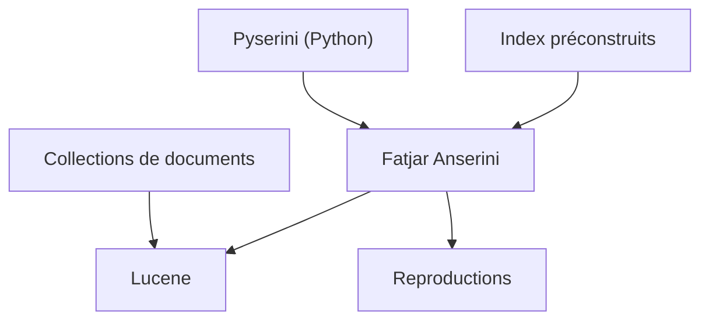

# castorini/anserini

> Lucene toolkit for reproducible information retrieval, for researchers and research engineers.

## The problem
Reproducing information retrieval results across varied engines is hard and rarely comparable.

## What it actually does
It builds on Lucene to provide reproducible ranking baselines, with prebuilt indexes, document collections and reproductions of results. It ships as a standalone fatjar, and most of it is also exposed through the Python interface Pyserini. Skills guide an agent in setting up the environment.

## How it is wired
Simplified diagram based on the sheet, no diagram provided.



## Trying it
```bash
# Aucune commande documentée dans ce README : il renvoie vers des pages d'installation (fatjar ou environnement de dev).
```

## Cost and gotchas
Free. Java required (Lucene). The `tools/` submodule was removed in August 2026 and any state prior to commit `9bfc04b` is probably broken.

## What it is not
Not a turnkey application search engine: it is a research and reproducibility tool. The README provided has no example command.

## Alternatives
Pyserini: the Python interface for those who prefer that language.

## For you
Watch: a reference if you build or evaluate retrieval (BM25, baselines) for a RAG, otherwise too academic.
