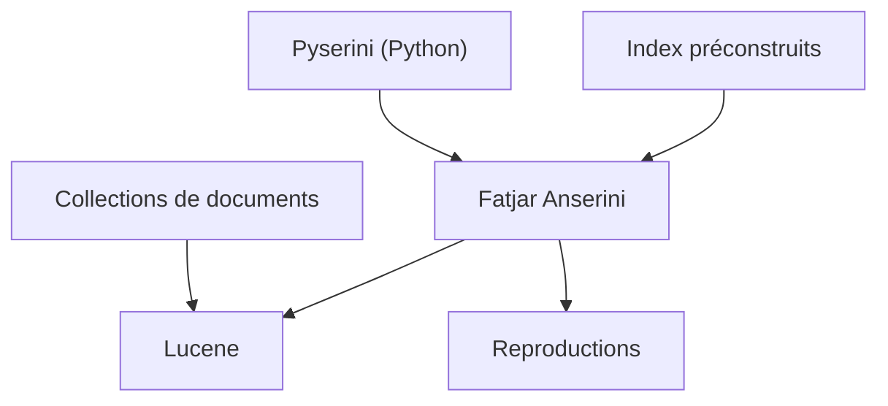

# castorini/anserini

> Boîte à outils Lucene pour la recherche d'information reproductible, pour chercheurs et ingénieurs de recherche.

## Le problème
Reproduire des résultats de recherche d'information avec des moteurs variés est difficile et rarement comparable.

## Ce que ça fait vraiment
Il s'appuie sur Lucene pour fournir des baselines de classement reproductibles, avec des index préconstruits, des collections de documents et des reproductions de résultats. Il est livré en fatjar autonome, et l'essentiel est aussi exposé via l'interface Python Pyserini. Des skills guident un agent pour installer l'environnement.

## Comment c'est branché
Schéma simplifié d'après la fiche, sans diagramme fourni.



## Essayer
```bash
# Aucune commande documentée dans ce README : il renvoie vers des pages d'installation (fatjar ou environnement de dev).
```

## Coût et pièges
Gratuit. Java requis (Lucene). Le sous-module `tools/` a été retiré en août 2026 et tout état antérieur au commit `9bfc04b` est probablement cassé.

## Ce que ce n'est pas
Pas un moteur de recherche applicatif clé en main : c'est un outil de recherche et de reproductibilité. Le README fourni n'a pas de commande d'exemple.

## Alternatives
Pyserini : l'interface Python pour qui préfère ce langage.

## Pour toi
Surveiller : référence si tu construis ou évalues du retrieval (BM25, baselines) pour un RAG, sinon trop académique.

