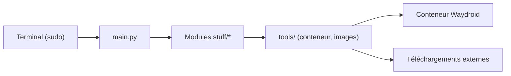

# casualsnek/waydroid_script

> A Python script that adds GApps, Magisk, ARM translation and other extras to Waydroid.

## The problem
Bare Waydroid lacks Google services, ARM translation and DRM to run many applications.

## What it actually does
A CLI (`main.py`) with subcommands `install`, `uninstall`, `hack`, `certified`: GApps, Magisk, libndk, libhoudini, Widevine L3, microG, SmartDock, a self-signed CA certificate, permission fixes. One module per feature, `resetprop` binaries per architecture.

## How it is wired


## Trying it
```bash
git clone https://github.com/casualsnek/waydroid_script
cd waydroid_script
python3 -m venv venv
venv/bin/pip install -r requirements.txt
sudo venv/bin/python3 main.py install gapps
```

## Cost and gotchas
Runs as root; `lzip` required. The `nodataperm` hack replaces `service.jar` and can prevent Waydroid from starting. Registering the device with Google requires an account.

## What it is not
Not a full Android management tool. The MITM certificate and the permission hacks (777) weaken the container's security.

## Alternatives
- waydroid-magisk: recommended for more advanced Magisk management.

## For you
Ignore: usefulness limited to Waydroid on a Linux workstation, with no link to the data/AI/MLOps trade.
