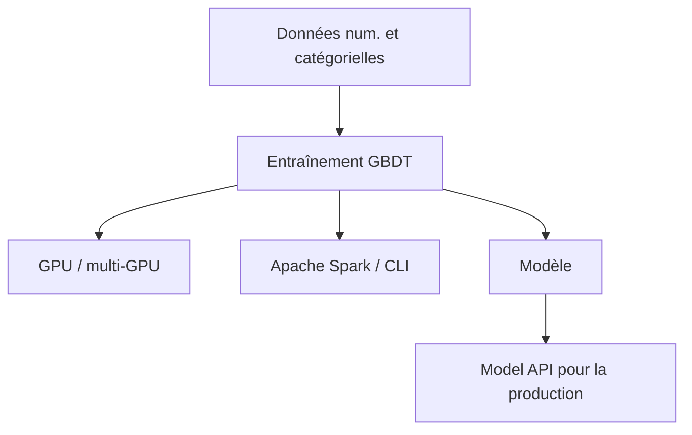

# catboost/catboost

> Gradient boosting library on decision trees, with categorical features and GPU support, from Yandex.

## The problem
Classic boosting handles categorical features poorly and requires manual encoding and heavy tuning.

## What it actually does
Tree-based gradient boosting that directly accepts numerical and categorical features. GPU and multi-GPU training, built-in visualization tools, distributed training via Apache Spark, and a CLI. Packages for Python, R, command line and Spark, plus a model evaluation API for production.

## How it is wired

Diagram inferred from the README, no diagram provided.

## Trying it
```bash
# Aucune commande dans le README : il renvoie au guide d'installation (paquets Python, R, CLI, Spark).
```

## Cost and gotchas
Free. GPU optional for acceleration. The README notes that the documentation may be blocked by some domain blockers (yastatic.net).

## What it is not
Not a deep learning framework. The "superior quality" and "prediction speed" claims come from the authors, with no figures in the README.

## Alternatives
No alternative named in the README.

## For you
Adopt: proven reference for tabular data with categorical features, Apache-2.0 license and a very active project.
