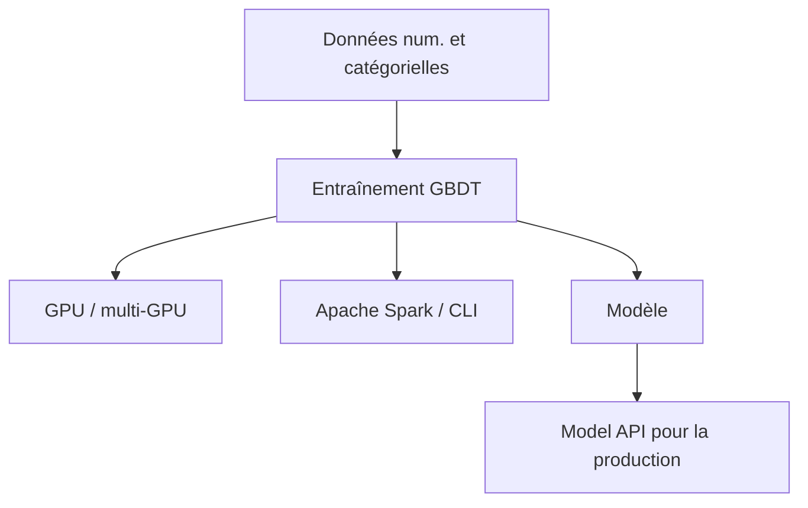

# catboost/catboost

> Bibliothèque de gradient boosting sur arbres de décision, avec variables catégorielles et GPU, de Yandex.

## Le problème
Le boosting classique gère mal les variables catégorielles et demande un encodage manuel et un réglage lourd.

## Ce que ça fait vraiment
Gradient boosting sur arbres qui accepte directement les variables numériques et catégorielles. Entraînement GPU et multi-GPU, outils de visualisation intégrés, entraînement distribué via Apache Spark et CLI. Paquets pour Python, R, ligne de commande et Spark, plus une API d'évaluation de modèle pour la production.

## Comment c'est branché

Schéma déduit du README, sans diagramme fourni.

## Essayer
```bash
# Aucune commande dans le README : il renvoie au guide d'installation (paquets Python, R, CLI, Spark).
```

## Coût et pièges
Gratuit. GPU optionnel pour l'accélération. Le README signale que la documentation peut être bloquée par certains bloqueurs de domaines (yastatic.net).

## Ce que ce n'est pas
Pas un framework de deep learning. Les affirmations « qualité supérieure » et « vitesse de prédiction » viennent des auteurs, sans chiffres dans le README.

## Alternatives
Aucune alternative nommée dans le README.

## Pour toi
Adopter : référence éprouvée pour les données tabulaires avec variables catégorielles, licence Apache-2.0 et projet très actif.

