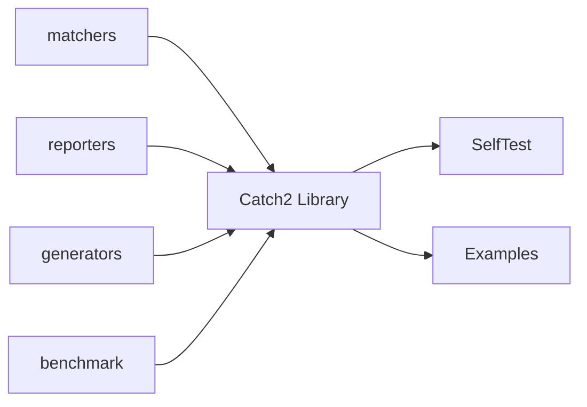

# catchorg/Catch2

> C++ unit testing framework with micro-benchmarks and BDD macros.

## The problem
Writing readable C++ tests without constrained identifier names or special assertions.

## What it actually does
Freely named test cases, assertions written as ordinary C++ boolean expressions (`REQUIRE`), sections to share setup and teardown, micro-benchmarks (`BENCHMARK`, run via `[!benchmark]`) and BDD macros. v3 is no longer a single header: it is compiled as a library.

## How it is wired


## Trying it
```cpp
#include <catch2/catch_test_macros.hpp>
TEST_CASE( "Factorials are computed", "[factorial]" ) {
    REQUIRE( factorial( 3) == 6 );
}
```

## Cost and gotchas
Free. The `devel` branch carries v3; v2 is on `v2.x`. The documentation is still being updated.

## What it is not
Not a data/AI tool: a C++ testing framework.

## Alternatives
None named in the README.

## For you
Ignore: only useful for writing C++ extensions; you test in Python.
