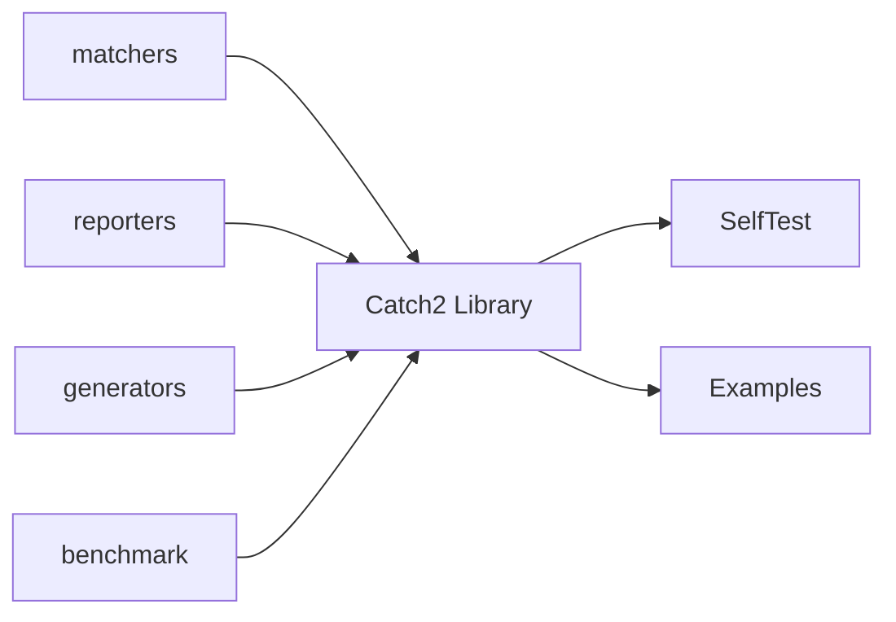

# catchorg/Catch2

> Framework de tests unitaires C++ avec micro-benchmarks et macros BDD.

## Le problème
Écrire des tests C++ lisibles sans noms d'identifiants contraints ni assertions spéciales.

## Ce que ça fait vraiment
Cas de test nommés librement, assertions sous forme d'expressions booléennes C++ ordinaires (`REQUIRE`), sections pour partager mise en place et nettoyage, micro-benchmarks (`BENCHMARK`, lancés via `[!benchmark]`) et macros BDD. La v3 n'est plus un en-tête unique : elle se compile comme une bibliothèque.

## Comment c'est branché


## Essayer
```cpp
#include <catch2/catch_test_macros.hpp>
TEST_CASE( "Factorials are computed", "[factorial]" ) {
    REQUIRE( factorial( 3) == 6 );
}
```

## Coût et pièges
Gratuit. Le branche `devel` porte la v3 ; la v2 est sur `v2.x`. La documentation est encore en cours de mise à jour.

## Ce que ce n'est pas
Pas un outil pour data/IA : un framework de test C++.

## Alternatives
Aucune nommée dans le README.

## Pour toi
Ignorer : utile seulement pour écrire des extensions C++ ; tu testes en Python.

