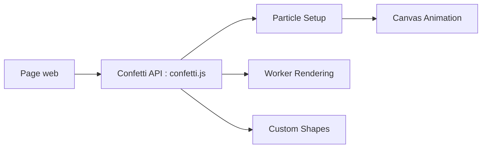

# catdad/canvas-confetti

> Browser library for confetti animation on a canvas, called from a web page.

## The problem
Adding a celebration effect to a page without writing a particle engine.

## What it actually does
The `confetti(options)` function creates particles (count, angle, spread, gravity, colors, square/circle/star shapes, SVG paths or emoji), animates them on a canvas and returns a promise. `confetti.create` targets a specific canvas, with optional rendering in a web worker. A `disableForReducedMotion` option respects motion preferences.

## How it is wired


## Trying it
```bash
npm install --save canvas-confetti
```
```html
<script src="https://cdn.jsdelivr.net/npm/canvas-confetti@1.9.4/dist/confetti.browser.min.js"></script>
```

## Cost and gotchas
Free. With `useWorker: true`, the canvas is transferred to the worker and can no longer be manipulated. Does not run in Node.

## What it is not
Not a data visualization tool. Chaotic confetti can be bothersome: enable `disableForReducedMotion`.

## Alternatives
- No alternative named in the README.

## For you
Ignore: visual gadget, with no use in a data/AI or MLOps workflow.
