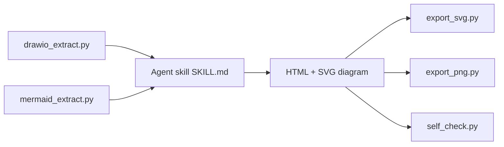

# cathrynlavery/diagram-design

> Ability of an agent to create standalone HTML+SVG diagrams in your brand's colors.

## The problem
The diagrams generated by a model are generic and do not resemble the rest of the website or blog.

## What it actually does
A skill that can be installed in Claude Code, Cursor, Codex, etc., which selects one of 45 types (architecture, sequence, quadrant, Sankey diagrams, etc.), and then generates an `.html` file with SVG graphics, without JavaScript or dependencies except for Google fonts (which can be disabled). The onboarding process extracts color palettes and fonts from a URL. It also redraws draw.io, Mermaid, and Excalidraw files, and exports them as SVG/PNG.

## How it is wired


## Trying it
```bash
npx skills add cathrynlavery/diagram-design
/plugin marketplace add cathrynlavery/diagram-design
/plugin install diagram-design@diagram-design
```

## Cost and gotchas
Free; the quality depends on the model used. Exporting as PNG requires `pip install playwright && playwright install chromium`. Fonts are sourced from Google Fonts, except in system mode.

## What it is not
Not a versionable source format: the same prompt can produce two different layouts, and there is nothing to submit in a pull request. The README recommends Mermaid for diagrams that change with each sprint.

## Alternatives
Mermaid / PlantUML: for text-based diagrams that can be easily compared. draw.io / Excalidraw: for manual editing.

## For you
Things to watch out for: useful for creating colorful publications (reports, presentations) for a client; not very relevant for live technical documentation.
