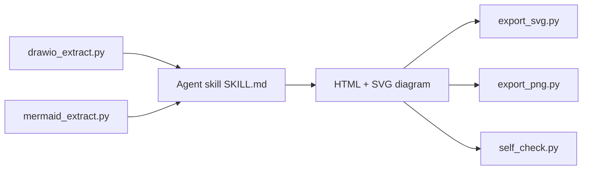

# cathrynlavery/diagram-design

> Skill d'agent qui dessine des diagrammes HTML+SVG autonomes aux couleurs de ta marque.

## Le problème
Les diagrammes générés par un modèle sont génériques et ne ressemblent pas au reste du site ou du blog.

## Ce que ça fait vraiment
Un skill installable dans Claude Code, Cursor, Codex, etc. qui choisit un type parmi 45 (architecture, séquence, quadrant, sankey…), puis écrit un fichier `.html` avec SVG en ligne, sans JavaScript ni dépendance sauf polices Google (désactivables). Un onboarding extrait palette et polices d'une URL. Il redessine aussi des fichiers draw.io, Mermaid et Excalidraw, et exporte en SVG/PNG.

## Comment c'est branché


## Essayer
```bash
npx skills add cathrynlavery/diagram-design
/plugin marketplace add cathrynlavery/diagram-design
/plugin install diagram-design@diagram-design
```

## Coût et pièges
Gratuit ; la qualité dépend du modèle utilisé. L'export PNG demande `pip install playwright && playwright install chromium`. Les polices passent par Google Fonts sauf mode `system`.

## Ce que ce n'est pas
Pas un format source versionnable : le même prompt peut produire deux mises en page différentes, et rien à diffuser dans une pull request. Le README recommande Mermaid pour les diagrammes qui changent à chaque sprint.

## Alternatives
Mermaid / PlantUML : pour des diagrammes en texte qui se diffent. draw.io / Excalidraw : pour éditer à la main.

## Pour toi
À surveiller : utile pour des schémas de publication (rapports, présentations) aux couleurs d'un client ; peu pertinent pour la documentation technique vivante.

