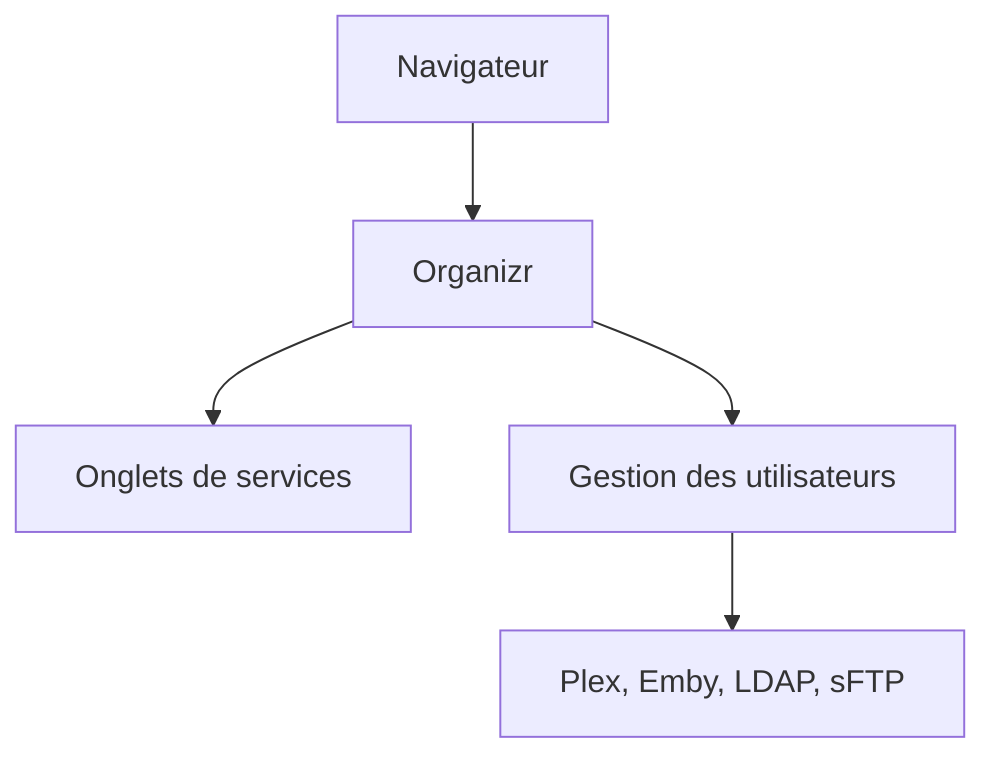

# causefx/Organizr

> Web dashboard that groups the services of a home server into tabs.

## The problem
With many services on a server, you have to remember IP addresses and ports and manage bookmarks.

## What it actually does
Loads all your services into a single web page through tabs (iFrame can be enabled). Manages accounts, groups and guests, with Plex, Emby, LDAP or sFTP login, themes, keyboard shortcuts, Nginx auth_request and fail2ban support. PHP 7.2+ version.

## How it is wired
Simplified diagram based on the sheet, no diagram provided.



## Trying it
```bash
docker create \
  --name=organizr \
  -v <path to data>:/config \
  -e PGID=<gid> -e PUID=<uid>  \
  -p 80:80 \
  organizr/organizr
```

## Cost and gotchas
Free. Requires a Docker server. The README notes that the official site and wiki will be refreshed, so documentation is lagging.

## What it is not
Not a monitoring or security tool: a tab portal. GPL-3.0 license, copyleft.

## Alternatives
No alternative named in the README.

## For you
Ignore: useful for a homelab, not for data, AI or MLOps workflows.
