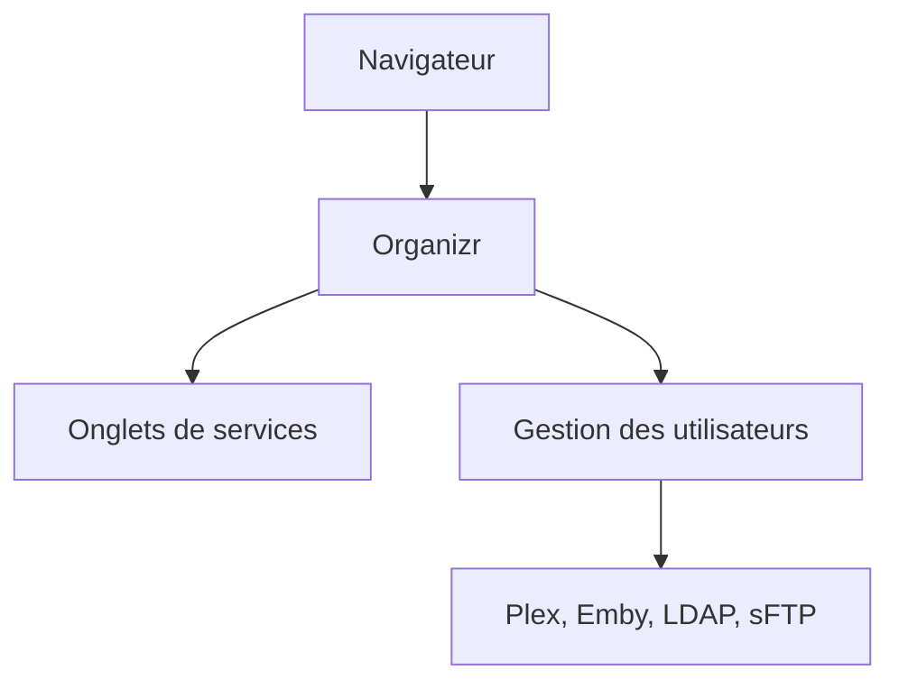

# causefx/Organizr

> Tableau de bord web qui regroupe en onglets les services d'un serveur domestique.

## Le problème
Avec beaucoup de services sur un serveur, il faut retenir des adresses IP et des ports et gérer des signets.

## Ce que ça fait vraiment
Charge tous tes services dans une seule page web via des onglets (iFrame activable). Gère des comptes, groupes et invités, avec connexion Plex, Emby, LDAP ou sFTP, thèmes, raccourcis clavier, support Nginx auth_request et fail2ban. Version PHP 7.2+.

## Comment c'est branché
Schéma simplifié d'après la fiche, sans diagramme fourni.



## Essayer
```bash
docker create \
  --name=organizr \
  -v <path to data>:/config \
  -e PGID=<gid> -e PUID=<uid>  \
  -p 80:80 \
  organizr/organizr
```

## Coût et pièges
Gratuit. Besoin d'un serveur Docker. Le README signale que site officiel et wiki seront rafraîchis, donc documentation en retrait.

## Ce que ce n'est pas
Pas un outil de supervision ni de sécurité : un portail d'onglets. Licence GPL-3.0, copyleft.

## Alternatives
Aucune alternative nommée dans le README.

## Pour toi
À ignorer : utile pour un homelab, pas pour des flux data, IA ou MLOps.

