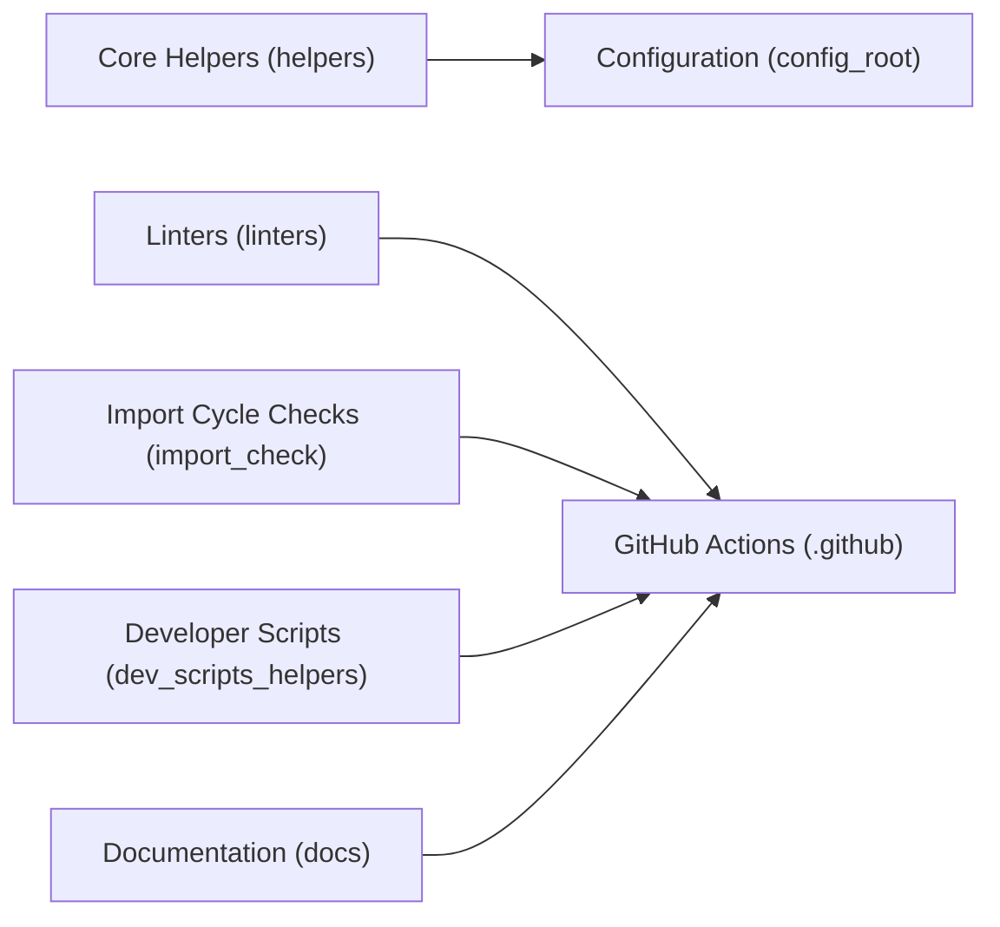

# causify-ai/helpers

> Causify's Python toolbox: utilities, linters and automations for production repositories.

## The problem
Teams accumulate duplicated, poorly tested scripts and code snippets for I/O, Git, Docker or pandas.

## What it actually does
A `helpers/` package of small modules named `h*.py` (hdbg, hio, hsystem, hgit, hdocker, hpandas…) plus LLM wrappers (`hllm`, `hllm_cost`, `hllm_cli`) for completions, structured outputs, caching and cost tracking. It also includes `config_root/`, dev scripts, linters, an import check, CI workflows, notebooks and an MkDocs site.

## How it is wired


## Trying it
```bash
git submodule add https://github.com/causify-ai/helpers.git helpers_root
python -m venv .venv
source .venv/bin/activate
pip install -e .
pytest -q
```

## Cost and gotchas
Free; the LLM functions use OpenAI or OpenRouter, so API keys and costs apply. The 164 open issues suggest active work; the internal API may change.

## What it is not
Not a framework: a grab bag of internal modules, with scattered documentation. Not designed as a stable published dependency.

## Alternatives
No alternative named in the README.

## For you
Keep an eye on it: a few modules (hllm with cost tracking, hpandas) may inspire you, but it is better to copy ideas than to depend on the whole repository.
