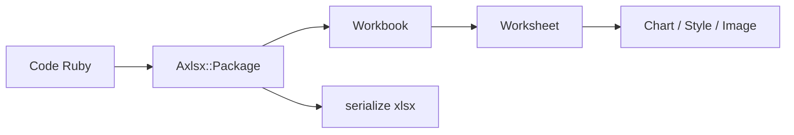

# caxlsx/caxlsx

> Ruby gem that generates Excel (xlsx) workbooks with charts, styles and validation, for Ruby developers.

## The problem
Producing valid Excel reports from Ruby without mastering the Office Open XML specification.

## What it actually does
Generates xlsx files: sheets, styles, formulas, images, tables, charts, filters, password protection. Data types are detected automatically. Formulas are escaped by default since version 4.0 to prevent injection. Output to a file or a stream.

## How it is wired
Simplified diagram based on the sheet, no diagram provided.


## Trying it
```bash
gem install caxlsx
```
```ruby
Axlsx::Package.new do |p|
  p.workbook.add_worksheet(:name => "Pie Chart") do |sheet|
    sheet.add_row ["Simple Pie Chart"]
  end
  p.serialize('simple.xlsx')
end
```

## Cost and gotchas
Free. Requires Ruby 2.6 or newer. Encryption requires the ooxml_crypt gem, limited to MRI. LibreOffice, Google Docs and Numbers render some charts and images poorly.

## What it is not
It is not an xlsx reader: it only writes. It is not user support: usage questions go on Stack Overflow, not in the issues.

## Alternatives
- caxlsx_rails: render `.axlsx` directly in Rails views.
- acts_as_caxlsx: ActiveRecord integration.
- activeadmin-caxlsx: downloadable reports in Active Admin.

## For you
Worth watching: useful only if you export Excel reports from Ruby, which is rare in a data / AI / MLOps profile.
