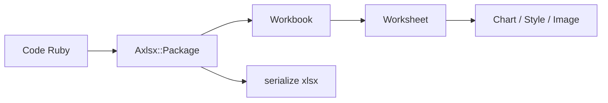

# caxlsx/caxlsx

> Gem Ruby qui génère des classeurs Excel (xlsx) avec graphiques, styles et validation, pour développeurs Ruby.

## Le problème
Produire des rapports Excel valides depuis Ruby sans maîtriser la spécification Office Open XML.

## Ce que ça fait vraiment
Génère des fichiers xlsx : feuilles, styles, formules, images, tableaux, graphiques, filtres, protection par mot de passe. Les types de données sont détectés automatiquement. Les formules sont échappées par défaut depuis la version 4.0 pour éviter l'injection. Sortie vers fichier ou flux.

## Comment c'est branché
Schéma simplifié d'après la fiche, sans diagramme fourni.


## Essayer
```bash
gem install caxlsx
```
```ruby
Axlsx::Package.new do |p|
  p.workbook.add_worksheet(:name => "Pie Chart") do |sheet|
    sheet.add_row ["Simple Pie Chart"]
  end
  p.serialize('simple.xlsx')
end
```

## Coût et pièges
Gratuit. Il faut Ruby 2.6 ou plus récent. Le chiffrement exige la gem ooxml_crypt, limitée à MRI. LibreOffice, Google Docs et Numbers rendent mal certains graphiques et images.

## Ce que ce n'est pas
Ce n'est pas un lecteur de xlsx : il écrit seulement. Ce n'est pas un support utilisateur : les questions d'usage vont sur Stack Overflow, pas dans les issues.

## Alternatives
- caxlsx_rails : rendu `.axlsx` directement dans les vues Rails.
- acts_as_caxlsx : intégration ActiveRecord.
- activeadmin-caxlsx : rapports téléchargeables dans Active Admin.

## Pour toi
À surveiller : utile seulement si tu exportes des rapports Excel depuis du Ruby, rare dans un profil data / IA / MLOps.

