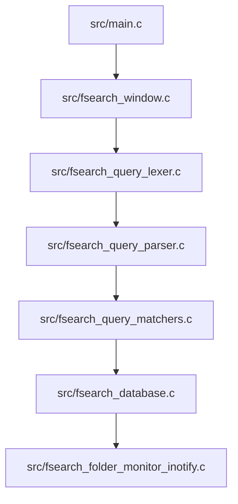

# cboxdoerfer/fsearch

> Instant file search for Linux, inspired by Everything, for advanced users.

## The problem
Linux file search tools are slow or tied to a desktop environment, far from the speed of Everything on Windows.

## What it actually does
A GTK3 application written in C that indexes the chosen folders and displays results as you type, with advanced syntax, wildcards, regex and filters. The index is kept up to date by inotify. The typed text goes through a lexer, a parser and then query evaluators.

## How it is wired
Diagram based on the one provided.

## Trying it
The README gives no command: it points to per-distribution packages (Ubuntu PPA, official Arch repository, Fedora COPR, Flathub with limited features).

## Cost and gotchas
Free. Dependencies: GTK 3.24, GLib 2.60, PCRE2, ICU. Sorting by type is slow, and moving to the trash does not update the index.

## What it is not
Not a content search engine: it searches file names. No command-line interface (the README points to fzf, find, locate).

## Alternatives
- fzf: for the command line.
- find and (m)locate: the classic tools.

## For you
Worth watching: handy on a Linux workstation to quickly find notebooks and datasets, with no further interest for your pipelines.
