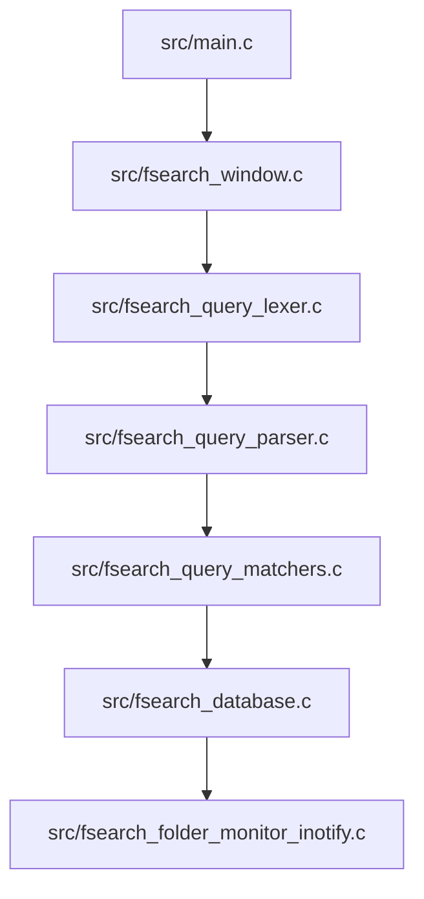

# cboxdoerfer/fsearch

> Recherche de fichiers instantanée pour Linux, inspirée d'Everything, pour utilisateurs avancés.

## Le problème
Les outils de recherche de fichiers Linux sont lents ou liés à un environnement de bureau, loin de la rapidité d'Everything sous Windows.

## Ce que ça fait vraiment
Application GTK3 écrite en C qui indexe les dossiers choisis et affiche les résultats au fil de la frappe, avec syntaxe avancée, jokers, regex et filtres. L'index est tenu à jour par inotify. Le texte saisi passe par un lexeur, un analyseur puis des évaluateurs de requête.

## Comment c'est branché
Schéma d'après le diagramme fourni.

## Essayer
Le README ne donne pas de commande : il renvoie à des paquets par distribution (PPA Ubuntu, dépôt officiel Arch, COPR Fedora, Flathub avec fonctions limitées).

## Coût et pièges
Gratuit. Dépendances : GTK 3.24, GLib 2.60, PCRE2, ICU. Le tri par type est lent, et la mise à la corbeille ne met pas l'index à jour.

## Ce que ce n'est pas
Pas un moteur de recherche de contenu : il cherche des noms de fichiers. Pas d'interface en ligne de commande (le README renvoie à fzf, find, locate).

## Alternatives
- fzf : pour la ligne de commande.
- find et (m)locate : les outils classiques.

## Pour toi
À surveiller : pratique sur un poste Linux de travail pour retrouver vite des notebooks et jeux de données, sans plus d'intérêt pour tes pipelines.

