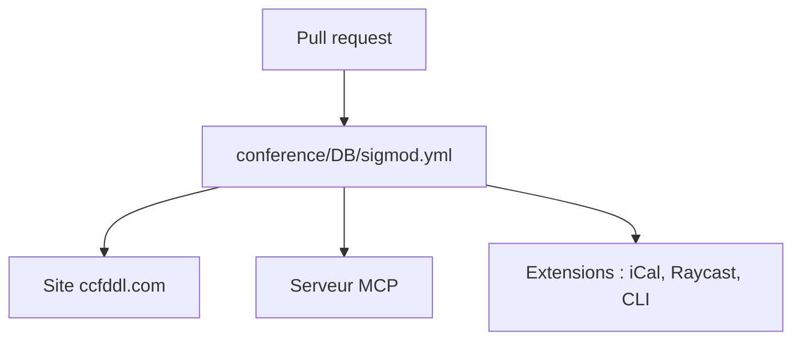

# ccfddl/ccf-deadlines

> Collaborative database of scientific conference deadlines, for researchers, with an MCP server and extensions.

## The problem
Submission deadlines are scattered across conference websites, with different time zones and rankings.

## What it actually does
One YAML file per conference (title, CCF/CORE/THCPL rank, dblp, year, deadline timeline, time zone, location), fed by pull requests. The website, a Python CLI, extensions (Raycast, SwiftBar, iCal, Chrome, TUI) and a read-only MCP server (`https://ccfddl.com/mcp`, Streamable HTTP) expose this data.

## How it is wired

Diagram not provided: deduced from the README.

## Trying it
```bash
# Pour contribuer : fork, ajouter conference/<type>/<nom>.yml, pull request.
# MCP : se connecter en Streamable HTTP à https://ccfddl.com/mcp
```

## Cost and gotchas
Free. TBD or default dates (23:59:59, AoE) are repository conventions, not always the official source.

## What it is not
Not a submission management tool. The data still has to be checked on each conference's official website.

## Alternatives
No alternative named in the README.

## For you
Adopt: the MCP server gives direct access to the deadlines of NeurIPS, ICML and others, useful to any AI profile that publishes.
