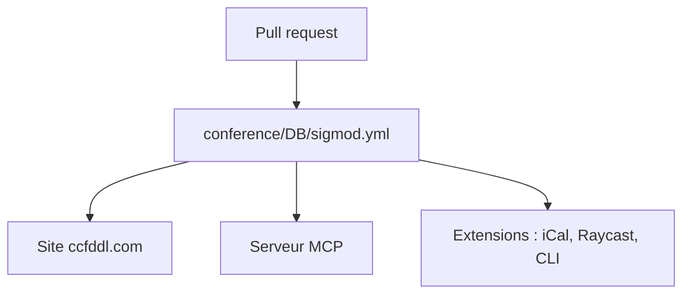

# ccfddl/ccf-deadlines

> Base collaborative des dates limites de conférences scientifiques, pour chercheurs, avec serveur MCP et extensions.

## Le problème
Les deadlines de soumission sont dispersées sur des sites de conférences, avec des fuseaux et rangs différents.

## Ce que ça fait vraiment
Un fichier YAML par conférence (titre, rang CCF/CORE/THCPL, dblp, année, timeline de deadlines, fuseau, lieu), alimenté par pull requests. Le site, une CLI Python, des extensions (Raycast, SwiftBar, iCal, Chrome, TUI) et un serveur MCP en lecture seule (`https://ccfddl.com/mcp`, Streamable HTTP) exposent ces données.

## Comment c'est branché

Schéma non fourni : déduit du README.

## Essayer
```bash
# Pour contribuer : fork, ajouter conference/<type>/<nom>.yml, pull request.
# MCP : se connecter en Streamable HTTP à https://ccfddl.com/mcp
```

## Coût et pièges
Gratuit. Les dates TBD ou par défaut (23:59:59, AoE) sont des conventions du dépôt, pas toujours la source officielle.

## Ce que ce n'est pas
Pas un outil de gestion de soumission. Les données restent à vérifier sur le site officiel de chaque conférence.

## Alternatives
Aucune alternative nommée dans le README.

## Pour toi
Adopter : le serveur MCP donne un accès direct aux deadlines de NeurIPS, ICML et autres, utile à tout profil IA qui publie.

