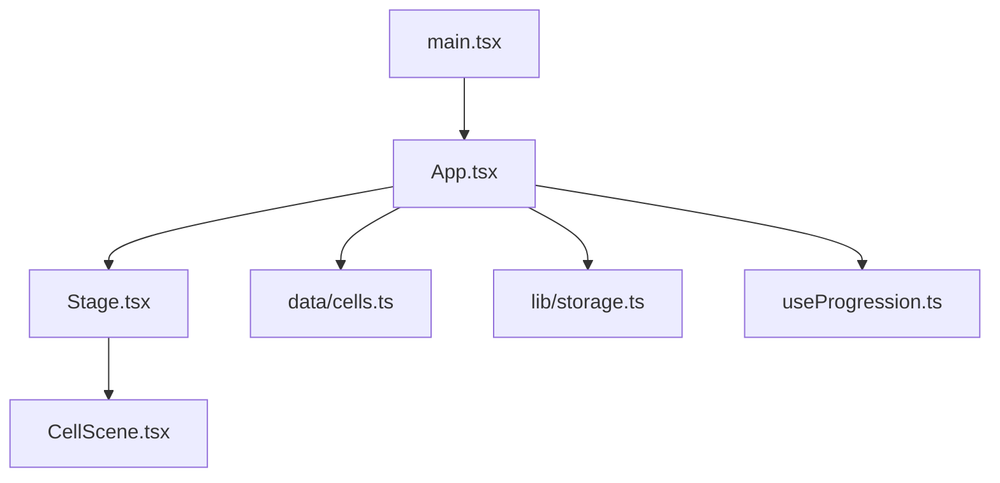

# cclank/cell-architecture-studio

> Interactive 3D gallery of biological cells for learning, built with React and Three.js.

## The problem
Static cell diagrams do little to help understand where organelles sit.

## What it actually does
Seven specimens (plant cell, white blood cell, neuron, epithelial cell, bacterium, animal cell, muscle cell) in 3D, with GLB models or procedural geometry. Organelle detail, a comparison mode, quizzes, flashcards, notebooks, XP-based progression, an "AI Tutor" panel and screenshot or GLB export.

## How it is wired


## Trying it
```bash
npm install
npm run dev
npm run build
npm run verify
```

## Cost and gotchas
Free. `npm run verify` assumes the app is running and Google Chrome is installed. The 3D models come from various sources (provenance in `docs/ASSETS.md`). Last push in July 2026: no recent commit according to the catalog.

## What it is not
Not a scientific tool: the "AI tutor" is a panel of learning prompts, with no documented model.

## Alternatives
No alternative named in the README.

## For you
Ignore: a 3D educational demo, unrelated to your work.
