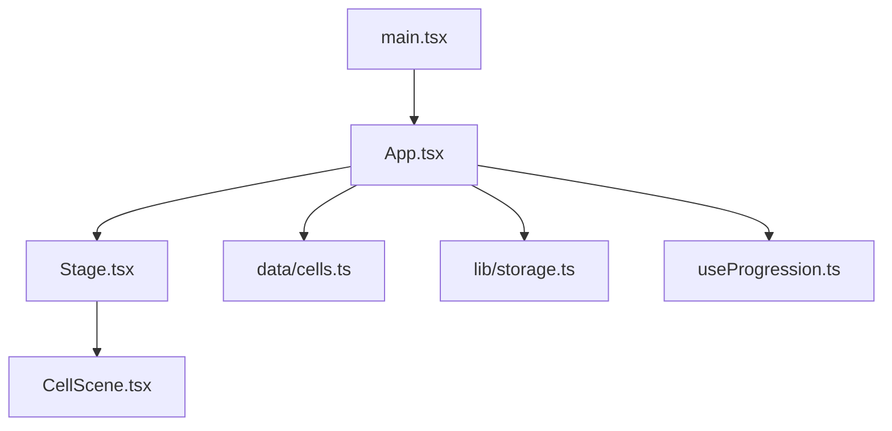

# cclank/cell-architecture-studio

> Galerie 3D interactive de cellules biologiques pour apprendre, construite avec React et Three.js.

## Le problème
Les schémas statiques de cellules aident peu à comprendre la position des organites.

## Ce que ça fait vraiment
Sept spécimens (cellule végétale, globule blanc, neurone, épithéliale, bactérie, animale, musculaire) en 3D, avec modèles GLB ou géométrie procédurale. Le détail des organites, un mode comparaison, des quiz, des flashcards, des carnets, une progression par XP, un panneau « AI Tutor » et un export de capture ou de GLB.

## Comment c'est branché


## Essayer
```bash
npm install
npm run dev
npm run build
npm run verify
```

## Coût et pièges
Gratuit. `npm run verify` suppose l'app lancée et Google Chrome. Les modèles 3D viennent de sources diverses (provenance dans `docs/ASSETS.md`). Dernier push en juillet 2026 : pas de commit récent d'après le catalogue.

## Ce que ce n'est pas
Ce n'est pas un outil scientifique : le « tuteur IA » est un panneau de prompts d'apprentissage, sans modèle documenté.

## Alternatives
Aucune alternative nommée dans le README.

## Pour toi
À ignorer : démonstration pédagogique en 3D, sans lien avec ton métier.

