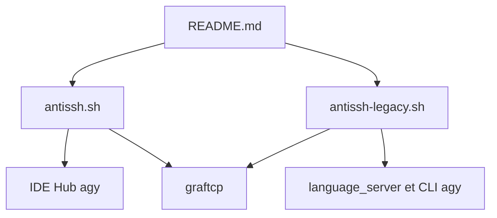

# ccpopy/antissh

> Bash scripts that route the Antigravity agent through a proxy via graftcp, on Linux and WSL.

## The problem
The remote agent of the Antigravity IDE does not always follow the proxy, which causes connection errors.

## What it actually does
`antissh.sh` wraps the IDE Hub `agy` binary, `antissh-legacy.sh` wraps the old `language_server` and the `agy` CLI, both with the graftcp wrapper. `installAntigravity.sh` installs the server by hand. It backs up the original binary (`.antiagy-original`), with the commands `check`, `install`, `status`, `restore`. The README is in Chinese.

## How it is wired


## Trying it
```bash
curl -fLO https://raw.githubusercontent.com/ccpopy/antissh/main/antissh.sh
bash antissh.sh check socks5://127.0.0.1:10808
bash antissh.sh install socks5://127.0.0.1:10808
bash antissh.sh status
```

## Cost and gotchas
Free. Linux or WSL only (graftcp relies on `ptrace`). It compiles graftcp and modifies IDE binaries: an IDE update may overwrite the wrapper. It depends on an already working proxy.

## What it is not
It is not a solution for macOS or Windows (the README suggests Proxifier or TUN mode). It does not replace the proxy.

## Alternatives
No alternative named as a repository (the README cites Proxifier, TUN mode and antigravity-proxy).

## For you
Ignore: a targeted workaround for one specific IDE, of no data / AI interest outside that case.
