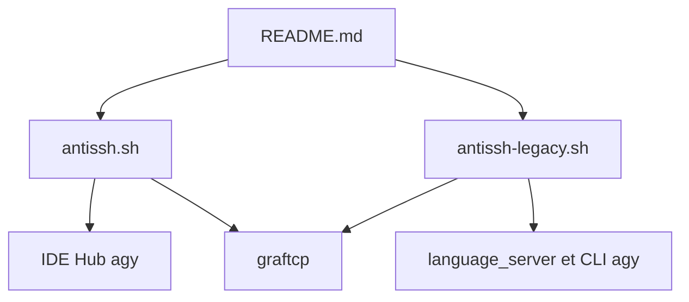

# ccpopy/antissh

> Scripts Bash qui font passer l'agent Antigravity par un proxy via graftcp, sous Linux et WSL.

## Le problème
L'agent distant de l'IDE Antigravity ne suit pas toujours le proxy, d'où des erreurs de connexion.

## Ce que ça fait vraiment
`antissh.sh` enveloppe le binaire `agy` de l'IDE Hub, `antissh-legacy.sh` enveloppe l'ancien `language_server` et le CLI `agy`, tous deux avec le wrapper graftcp. `installAntigravity.sh` installe le serveur à la main. Sauvegarde du binaire d'origine (`.antiagy-original`), commandes `check`, `install`, `status`, `restore`. README en chinois.

## Comment c'est branché


## Essayer
```bash
curl -fLO https://raw.githubusercontent.com/ccpopy/antissh/main/antissh.sh
bash antissh.sh check socks5://127.0.0.1:10808
bash antissh.sh install socks5://127.0.0.1:10808
bash antissh.sh status
```

## Coût et pièges
Gratuit. Linux ou WSL uniquement (graftcp repose sur `ptrace`). Compile graftcp et modifie des binaires de l'IDE : une mise à jour de l'IDE peut écraser le wrapper. Dépend d'un proxy déjà fonctionnel.

## Ce que ce n'est pas
Ce n'est pas une solution pour macOS ni Windows (le README propose Proxifier ou le mode TUN). Il ne remplace pas le proxy.

## Alternatives
Aucune alternative nommée sous forme de dépôt (le README cite Proxifier, le mode TUN et antigravity-proxy).

## Pour toi
À ignorer : un contournement ciblé pour un IDE précis, sans intérêt data / IA hors de ce cas.

