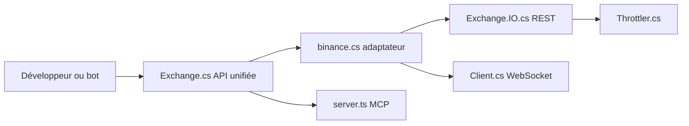

# ccxt/ccxt

> Unified API to query and trade on more than 100 crypto platforms, in eight languages, for developers and bots.

## The problem
Each platform has its own API, field names and rate limits; comparing or trading across several requires one integration per platform.

## What it actually does
CCXT provides one class per platform with the same methods (`loadMarkets`, `fetchTicker`, `createOrder`…) and normalized results, in REST and WebSocket ("pro" versions). The code is written in TypeScript then transpiled to Python, PHP, C#, Go, Java and Rust. It handles request signing and rate limiting (leaky bucket or sliding window). A CLI and an MCP server are added.

## How it is wired


## Trying it
```bash
pip install ccxt
npm install ccxt
npm i ccxt-cli -g
ccxt explain createOrder
claude mcp add ccxt -- npx -y ccxt-mcp
```

## Cost and gotchas
Public data needs no key; trading and balances require API keys created at each platform. On "builder code" platforms, 1 basis point is added to fees (can be disabled with `builderFee = False`). Trading orders act on real funds.

## What it is not
Neither a service nor a server, and it does not hold funds: non-custodial software, with no warranty (MIT). It creates neither accounts nor keys for you.

## Alternatives
- Freqtrade: a complete algorithmic trading bot rather than a library.
- OctoBot: bot with an advanced web interface.
- TokenBot: copies algorithmic traders.

## For you
Adopt to collect quotes, order books and OHLCV histories across platforms into your pipelines, keeping real trading under separate control.
