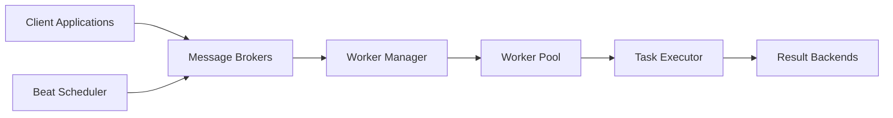

# celery/celery

> Distributed task queue in Python, for running background work on workers.

## The problem
Long-running jobs (ETL, inference, sending) block a web application unless they are offloaded to workers driven by a broker.

## What it actually does
The client publishes a task to a broker (RabbitMQ, Redis, SQS, Pub/Sub); workers consume it and store the result in a backend.
Prefork, eventlet, gevent or solo pools; Beat for periodic tasks.
Result backends: Redis, SQLAlchemy, Django ORM, S3, GCS, Elasticsearch…
Pip extras per feature (`celery[redis]`, `celery[sqs]`…).

## How it is wired


## Trying it
```bash
pip install -U Celery
pip install "celery[redis]"
```

## Cost and gotchas
Free but requires a broker (RabbitMQ or Redis) to operate. Windows not officially supported. v5.6 is the last to support Python 3.9.

## What it is not
Not an ML workflow orchestrator (no visual DAG or lineage). Transports other than RabbitMQ/Redis are experimental.

## Alternatives
- node-celery, gocelery, rusty-celery: clients of the same protocol in other languages, not replacements.

## For you
Adopt: the de facto standard for offloading inference and batch jobs behind a FastAPI API; BSD license according to the README, to be confirmed in the LICENSE file.
