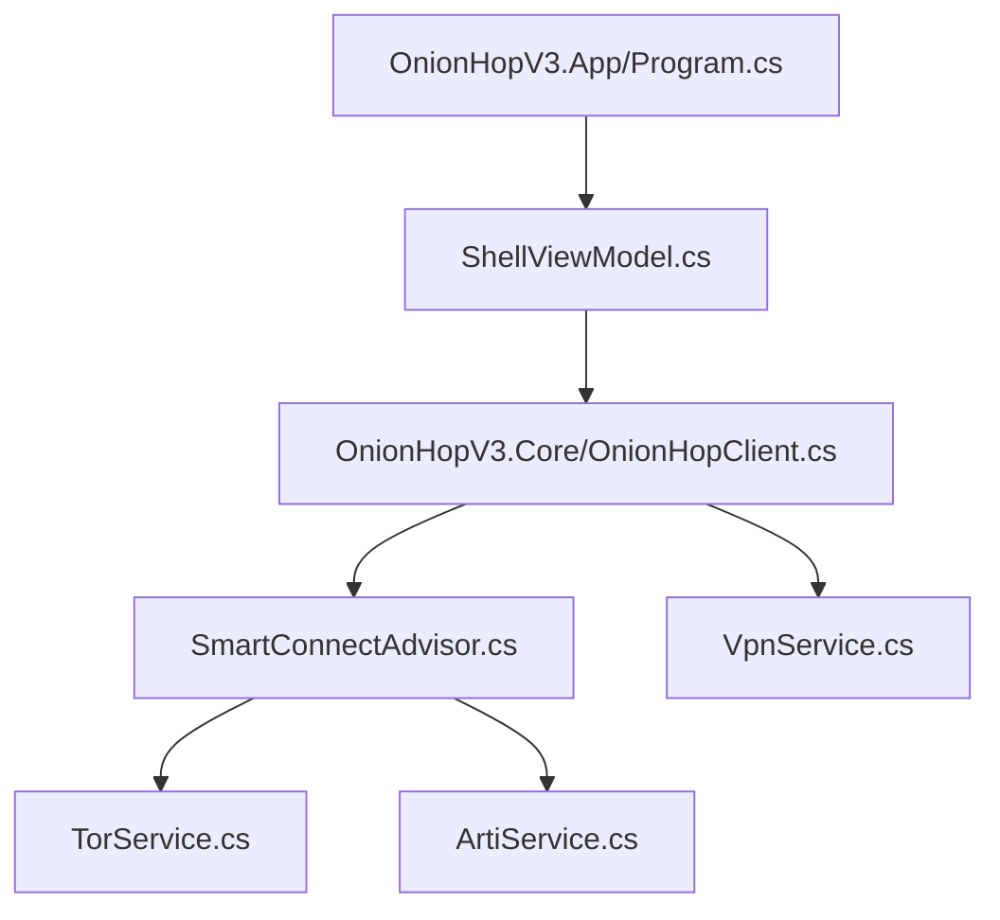

# center2055/OnionHop

> Desktop application that routes traffic through Tor, automatically choosing the best connection.

## The problem
Using Tor on a censored network requires manually finding bridges and transports that work.

## What it actually does
Runs Tor as a local SOCKS proxy or as a system tunnel (sing-box). "Smart Connect" picks an engine (Classic, Arti, ArtiHop) and a transport (obfs4, snowflake, webtunnel, etc.), and a scanner tests bridges. Interface in 8 languages, CLI and kill switch included.

## How it is wired


## Trying it
```bash
chmod +x OnionHop-x86_64.AppImage
./download-deps.sh
dotnet run --project OnionHop/src/OnionHopV3.App -c Release
```

## Cost and gotchas
Free. Tunnel mode requires administrator rights. ArtiHop (2 hops) reduces anonymity. Building: .NET SDK 9, Go or Rust optional.

## What it is not
Not a guarantee of anonymity: the README reminds that using Tor may be legally restricted. It is not a pentesting tool.

## Alternatives
No alternative named in the README.

## For you
Network privacy tool with no direct link to data / AI: ignore.
