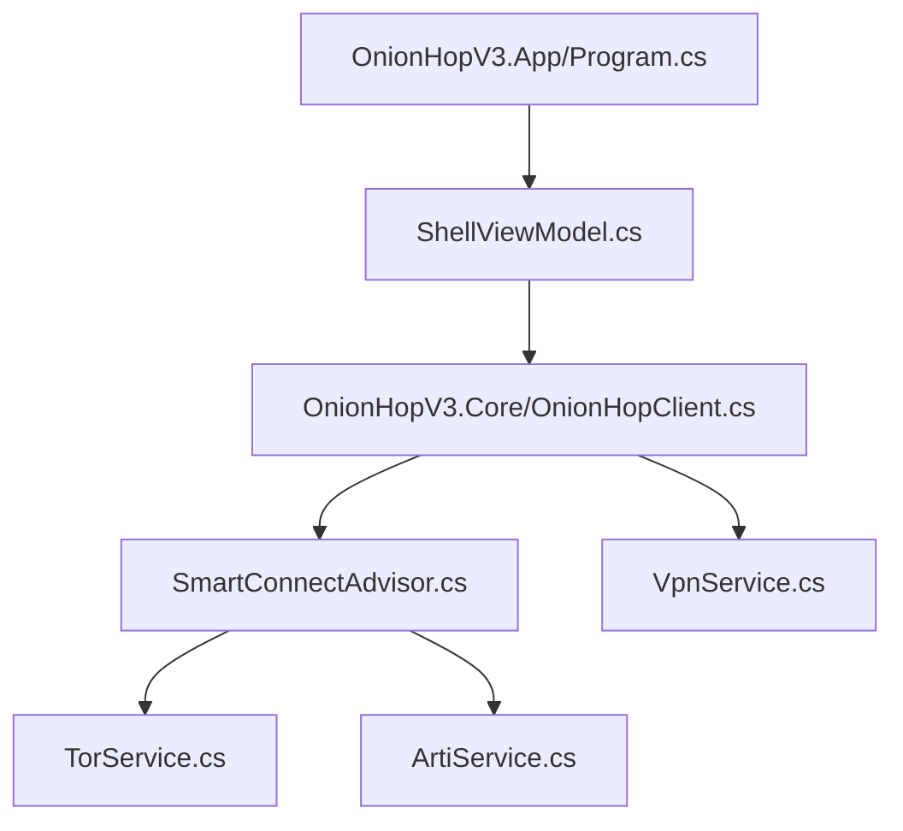

# center2055/OnionHop

> Application de bureau qui fait passer le trafic par Tor, avec choix automatique de la meilleure connexion.

## Le problème
Utiliser Tor sur un réseau censuré demande de trouver à la main des ponts et transports qui fonctionnent.

## Ce que ça fait vraiment
Lance Tor en proxy SOCKS local ou en tunnel système (sing-box). « Smart Connect » choisit un moteur (Classic, Arti, ArtiHop) et un transport (obfs4, snowflake, webtunnel, etc.), un scanner teste les ponts. Interface en 8 langues, CLI et kill switch inclus.

## Comment c'est branché


## Essayer
```bash
chmod +x OnionHop-x86_64.AppImage
./download-deps.sh
dotnet run --project OnionHop/src/OnionHopV3.App -c Release
```

## Coût et pièges
Gratuit. Le mode tunnel exige les droits administrateur. ArtiHop (2 sauts) réduit l'anonymat. Compilation : .NET SDK 9, Go ou Rust en option.

## Ce que ce n'est pas
Pas une garantie d'anonymat : le README rappelle que l'usage de Tor peut être restreint légalement. Ce n'est pas un outil de pentest.

## Alternatives
Aucune alternative nommée dans le README.

## Pour toi
Outil de confidentialité réseau sans lien direct avec la data / IA : à ignorer.

