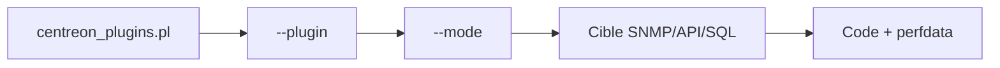

# centreon/centreon-plugins

> Nagios-compatible Perl monitoring plugins, for monitoring applications, cloud, databases, network and storage.

## The problem
Monitoring heterogeneous equipment (SNMP, API, SQL, CLI) requires a uniform set of probes.

## What it actually does
Each plugin returns a code (0 OK, 1 WARNING, 2 CRITICAL, 3 UNKNOWN), a message and perfdata. You list the plugins, choose a mode, and pass the options (hostname, SNMP, `--warning` / `--critical` thresholds). Covers Apache, AWS, Azure, Docker, Postgres, Cisco, Linux, etc.

## How it is wired


## Trying it
```bash
perl src/centreon_plugins.pl --list-plugin
perl centreon_plugins.pl --plugin=os::linux::snmp::plugin --mode=load --hostname=127.0.0.1 --snmp-version=2c --snmp-community=public
```

## Cost and gotchas
Free. Installation section not included in this README. No guaranteed response time on requests.

## What it is not
Not a monitoring platform: you need Centreon or a Nagios-compatible tool.

## Alternatives
No alternative named in the README.

## For you
Watch: useful if you monitor the infrastructure of your ML platforms with Nagios/Centreon; otherwise Prometheus will do.
