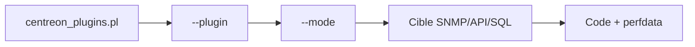

# centreon/centreon-plugins

> Plugins Perl de supervision compatibles Nagios, pour monitorer applications, cloud, bases, réseau et stockage.

## Le problème
Superviser des équipements hétérogènes (SNMP, API, SQL, CLI) demande un jeu de sondes uniforme.

## Ce que ça fait vraiment
Chaque plugin renvoie un code (0 OK, 1 WARNING, 2 CRITICAL, 3 UNKNOWN), un message et des perfdata. On liste les plugins, on choisit un mode, on passe les options (hostname, SNMP, seuils `--warning` / `--critical`). Couvre Apache, AWS, Azure, Docker, Postgres, Cisco, Linux, etc.

## Comment c'est branché


## Essayer
```bash
perl src/centreon_plugins.pl --list-plugin
perl centreon_plugins.pl --plugin=os::linux::snmp::plugin --mode=load --hostname=127.0.0.1 --snmp-version=2c --snmp-community=public
```

## Coût et pièges
Gratuit. Section d'installation non reprise dans ce README. Aucune garantie de délai sur les demandes.

## Ce que ce n'est pas
Ce n'est pas une plateforme de supervision : il faut Centreon ou un outil compatible Nagios.

## Alternatives
Aucune alternative nommée dans le README.

## Pour toi
À surveiller : utile si tu supervises l'infra de tes plateformes ML avec Nagios/Centreon ; sinon Prometheus suffira.

