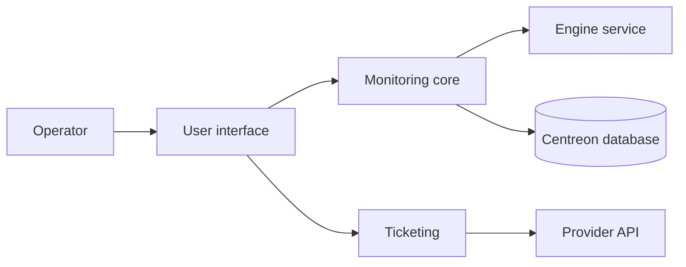

# centreon/centreon

> Open source IT and application monitoring platform, for operations teams.

## The problem
Without centralized monitoring, server and application outages are discovered by users.

## What it actually does
The README announces four installation modes: sources, packages, ISO, VM. From the code, the "monitoring" domain sends commands to the collection engine (`EngineService.php`), manages downtimes, legacy configuration (CLAPI, broker objects), the interface (charts with zoom, resource listings) and ticketing integrations. The analysis remains partial.

## How it is wired

## Trying it
No command in the README; the installation documentation is external (docs.centreon.com).

## Cost and gotchas
Free in the community edition, paid commercial support. One major release per year, 18-month cycle; the 3-year long-term support is paid.

## What it is not
Not a lightweight tool: it is a full platform to deploy and operate. The 332 open issues show a large surface to maintain.

## Alternatives
None cited in the README.

## For you
Worth watching: relevant if you need to monitor the infrastructure that carries your models, but the monitoring catalog (Prometheus and the like) is outside the README.
