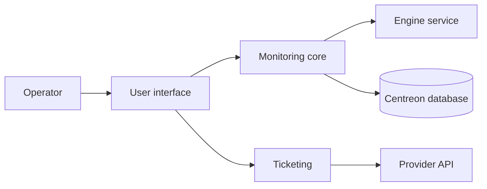

# centreon/centreon

> Plateforme de supervision IT et applicative, open source, pour équipes d'exploitation.

## Le problème
Sans supervision centralisée, les pannes de serveurs et d'applications se découvrent par les utilisateurs.

## Ce que ça fait vraiment
Le README annonce quatre modes d'installation : sources, paquets, ISO, VM. D'après le code, le domaine « monitoring » envoie des commandes au moteur de collecte (`EngineService.php`), gère les downtimes, la configuration héritée (CLAPI, objets broker), l'interface (graphiques avec zoom, listings de ressources) et des intégrations de ticketing. L'analyse reste partielle.

## Comment c'est branché

## Essayer
Aucune commande dans le README ; la documentation d'installation est externe (docs.centreon.com).

## Coût et pièges
Gratuit en communauté, support commercial payant. Une version majeure par an, cycle de 18 mois ; le support long terme de 3 ans est payant.

## Ce que ce n'est pas
Pas un outil léger : c'est une plateforme complète à déployer et exploiter. Les 332 issues ouvertes montrent une grosse surface à maintenir.

## Alternatives
Aucune citée dans le README.

## Pour toi
Surveiller : pertinent si tu dois superviser l'infra qui porte tes modèles, mais le catalogue de supervision (Prometheus et consorts) est hors du README.

