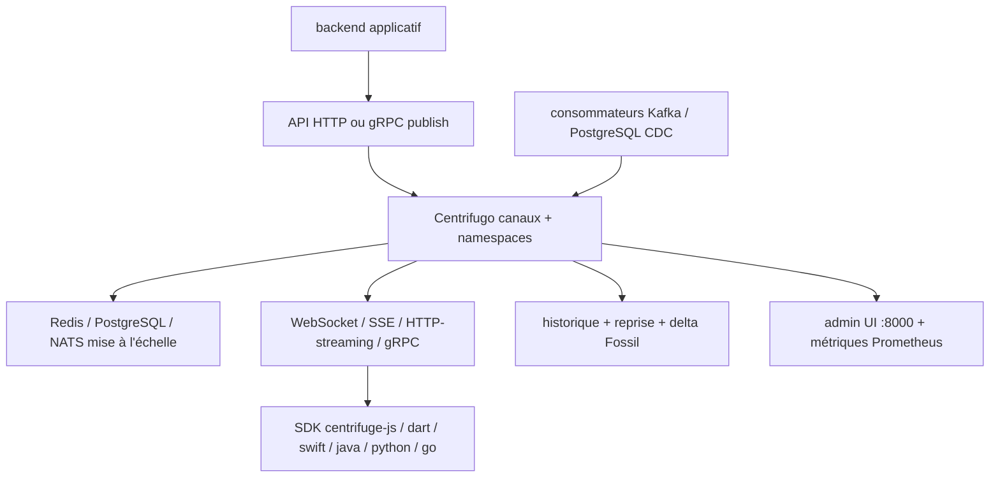

# centrifugal/centrifugo

> Language-agnostic real-time PUB/SUB messaging server between your backend and your clients.

## The problem
Adding real-time to an application mixes business logic with transport, and each client platform demands its own reconnection and resume implementation.
Holding many simultaneous connections requires infrastructure work that is not the application's business.

## What it actually does
Separates the real-time transport from the backend: the backend publishes to channels through an HTTP or gRPC API, and clients subscribe via an official SDK or in unidirectional mode without an SDK.
Transports: WebSocket, HTTP-streaming, Server-Sent Events, gRPC, WebTransport (experimental), with subscription multiplexing over a single connection.
Scaling through Redis (or compatible: Valkey, KeyDB, DragonflyDB, Elasticache), PostgreSQL or NATS; PostgreSQL and Kafka async consumers for transactional outbox and CDC.
Message history with automatic recovery on reconnection, cache mode, delta compression (Fossil algorithm), online presence with join/leave notifications, RPC to the backend, JWT or proxy authentication, admin UI and Prometheus metrics with a Grafana dashboard.

## How it is wired


## Trying it
```bash
docker run -it --rm -p 8000:8000 centrifugo/centrifugo:latest centrifugo \
  --client.insecure --admin.enabled --admin.insecure
```

## Cost and gotchas
Free; the cost is hosting, plus a Redis, PostgreSQL or NATS as soon as you move to multiple instances.
The `--client.insecure` and `--admin.insecure` options in the demo command remove authentication: the README explicitly forbids their use in production.

## What it is not
Not an internal message bus: it is a user-facing PUB/SUB, not a Kafka replacement — which it instead consumes.
Not a backend: it carries no business logic, it transports.
WebTransport is marked experimental, and the .NET/MAUI/Unity SDK is marked WIP.

## Alternatives
No alternative named; the README claims to provide features missing from other open-source solutions without naming them.

## For you
Useful for streaming model responses to varied clients without writing the transport layer.
