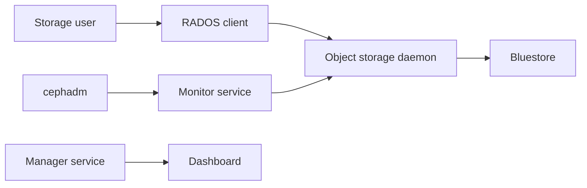

# ceph/ceph

> Distributed object, block and file storage for infrastructure operators; the README only covers building.

## The problem
Offering scalable, replicated storage on commodity servers, without a proprietary array.

## What it actually does
Based on the code: RADOS, RBD, CephFS and RADOS Gateway clients; Monitor, Manager, Metadata and OSD services; storage engines (BlueStore, Crimson); the cephadm orchestrator and a dashboard. The README itself only describes the build, the tests and vstart.

## How it is wired


## Trying it
```bash
git submodule update --init --recursive --progress
./install-deps.sh
./do_cmake.sh
cd build && ninja -j3
../src/vstart.sh --debug --new -x --localhost --bluestore
./bin/ceph -s
```

## Cost and gotchas
About 2.5 GiB of RAM per ninja job. A debug build can run at 20% of the performance of a non-debug build. For production installation, the README points to the .deb/.rpm packages.

## What it is not
Not a deployment guide: it explains how to build for development. Not lightweight: a real cluster requires several machines. A license is present but not identified by GitHub.

## Alternatives
No alternative named in the README.

## For you
Ignore unless you administer cluster storage: for ML datasets, managed object storage is enough and avoids operating Ceph.
