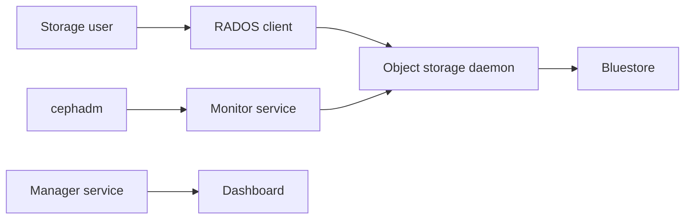

# ceph/ceph

> Stockage distribué objet, bloc et fichier pour opérateurs d'infrastructure ; le README ne couvre que la compilation.

## Le problème
Offrir un stockage extensible et répliqué sur des serveurs standards, sans baie propriétaire.

## Ce que ça fait vraiment
D'après le code : clients RADOS, RBD, CephFS et RADOS Gateway ; services Monitor, Manager, Metadata et OSD ; moteurs de stockage (BlueStore, Crimson) ; orchestrateur cephadm et tableau de bord. Le README, lui, ne décrit que le build, les tests et vstart.

## Comment c'est branché


## Essayer
```bash
git submodule update --init --recursive --progress
./install-deps.sh
./do_cmake.sh
cd build && ninja -j3
../src/vstart.sh --debug --new -x --localhost --bluestore
./bin/ceph -s
```

## Coût et pièges
Environ 2,5 Gio de RAM par job ninja. Un build debug peut tourner à 20 % des performances d'un build non-debug. Pour l'installation en production, le README renvoie aux paquets .deb/.rpm.

## Ce que ce n'est pas
Pas un guide de déploiement : il explique comment compiler le développement. Pas léger : un cluster réel exige plusieurs machines. Licence présente mais non identifiée par GitHub.

## Alternatives
Aucune alternative nommée dans le README.

## Pour toi
À ignorer sauf si tu administres du stockage de cluster : pour des jeux de données ML, un stockage objet géré suffit et évite l'exploitation de Ceph.

