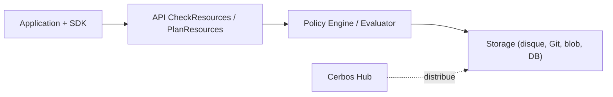

# cerbos/cerbos

> Authorization decision server that evaluates YAML policies to control access to resources.

## The problem
Access rules end up hard-coded in the application, difficult to audit and to evolve.

## What it actually does
The Cerbos PDP is a stateless service that loads YAML policies (disk, Git, object storage or database) and exposes two APIs: `CheckResources` (can this principal act?) and `PlanResources` (which resources are accessible?). It handles RBAC and ABAC through conditions, derived roles and principal policies. SDKs exist in eight languages, along with query plan adapters for Prisma and SQLAlchemy.

## How it is wired


## Trying it
```bash
cat <<EOF | curl --silent "http://localhost:3592/api/check/resources?pretty" -d @-
{ "requestId": "test01", "principal": {"id": "alicia", "roles": ["user"]},
  "resources": [{"actions": ["view"], "resource": {"id": "XX125", "kind": "album:object",
  "attr": {"owner": "alicia", "public": false, "flagged": false}}}] }
EOF
```

## Cost and gotchas
The PDP is free; Cerbos Hub is a cloud service requiring an account. Anonymous telemetry is on by default, to be turned off with `CERBOS_NO_TELEMETRY=1`.

## What it is not
Not an identity provider nor an authentication system: it only decides permissions.

## Alternatives
No alternative named in the README.

## For you
Worth watching: relevant if you expose APIs or agents needing fine-grained, auditable permissions; outside that case, it is one more component to operate.
