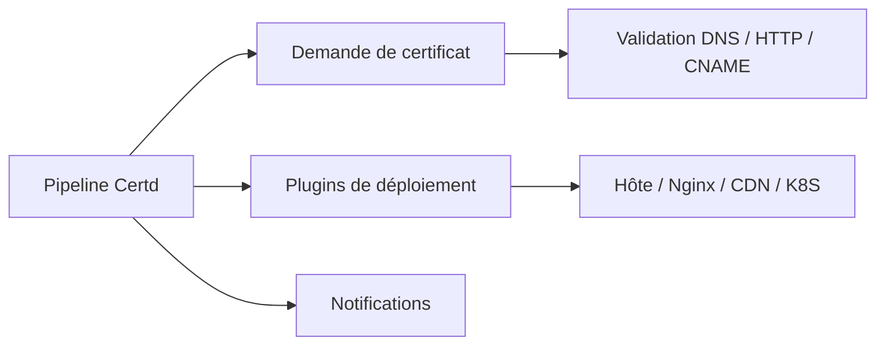

# certd/certd

> Self-hosted system that automatically requests and renews TLS certificates, then deploys them.

## The problem
Free certificates expire after 90 days; renewing and redeploying them by hand is a source of oversights.

## What it actually does
Works through pipelines: certificate request (DNS-01, HTTP-01, CNAME validations, wildcard domains), then deployment via more than 110 plugins (hosts, Alibaba, Tencent, Nginx, K8S, 1Panel...). Formats pem, pfx, der, jks, p7b. Notifications (email, webhook), expiry monitoring, 2FA, REST API, SQLite/PostgreSQL/MySQL databases. A Certd Client can fetch the certificate on the host.

## How it is wired


## Trying it
```bash
curl -fsSL https://gitee.com/certd/certd/raw/v2/docker/run/install.sh | bash
# Image : certd/certd:latest  (ou :stable pour la production)
```

## Cost and gotchas
Free in the base version, with limits; pro and commercial editions are paid (some plugins, notifications, unlimited monitoring). Commercial use is forbidden without a license, despite the AGPL. The data is highly sensitive: require HTTPS, a firewall and backups.

## What it is not
Not a plain ACME client free of any conditions: modifying the logo and notices is forbidden without permission. The install script comes from Gitee.

## Alternatives
None cited in the README.

## For you
Worth watching: useful for automating certificates for a model server, but the commercial clauses and the sole maintainer call for a reading of the license.
