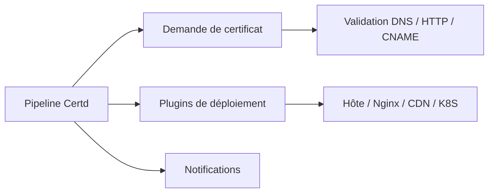

# certd/certd

> Système auto-hébergé qui demande et renouvelle automatiquement des certificats TLS puis les déploie.

## Le problème
Les certificats gratuits expirent au bout de 90 jours ; les renouveler et les redéployer à la main est source d'oublis.

## Ce que ça fait vraiment
Fonctionne par pipelines : demande de certificat (validations DNS-01, HTTP-01, CNAME, domaines génériques), puis déploiement via plus de 110 plugins (hôtes, Alibaba, Tencent, Nginx, K8S, 1Panel...). Formats pem, pfx, der, jks, p7b. Notifications (e-mail, webhook), surveillance d'expiration, 2FA, API REST, bases SQLite/PostgreSQL/MySQL. Un client Certd Client peut récupérer le certificat sur l'hôte.

## Comment c'est branché


## Essayer
```bash
curl -fsSL https://gitee.com/certd/certd/raw/v2/docker/run/install.sh | bash
# Image : certd/certd:latest  (ou :stable pour la production)
```

## Coût et pièges
Gratuit en version de base, avec limites ; édition pro et commerciale payantes (certains plugins, notifications, monitoring illimité). L'usage commercial est interdit sans licence, malgré l'AGPL. Les données sont très sensibles : exiger HTTPS, pare-feu et sauvegardes.

## Ce que ce n'est pas
Pas un simple client ACME libre de toute condition : modification du logo et des mentions interdite sans autorisation. Le script d'installation vient de Gitee.

## Alternatives
Aucune citée dans le README.

## Pour toi
Surveiller : utile pour automatiser des certificats d'un serveur de modèles, mais les clauses commerciales et le mainteneur unique appellent une lecture de la licence.

