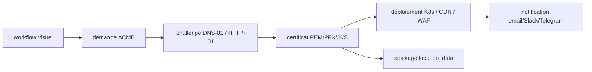

# certimate-go/certimate

> Self-hosted SSL certificate manager: request, deployment, renewal, monitoring.

## The problem
Renewing ACME certificates by hand across dozens of domains and redeploying them to CDNs, WAFs and load balancers always ends up producing a forgotten expiry.

## What it actually does
Orchestrates a visual end-to-end workflow: certificate request, deployment, renewal, notification.
Single, multiple and wildcard certificates, IP addresses, RSA or ECC keys, DNS-01 and HTTP-01 challenges.
More than 70 domain registrars and more than 160 deployment targets (Kubernetes, CDN, WAF, load balancers).
PEM, PFX, JKS formats; CAs Let's Encrypt, Actalis, Google Trust Services, SSL.com, ZeroSSL.

## How it is wired


## Trying it
```bash
docker run -d \
  --name certimate \
  --restart unless-stopped \
  -p 8090:8090 \
  -v $(pwd)/data:/app/pb_data \
  certimate/certimate:latest
```

## Cost and gotchas
Free, MIT. The default administrator account is `admin@certimate.fun` / `1234567890`: change it immediately. No database or runtime to install, ~20 MB of memory advertised.

## What it is not
Not a managed service: you host it, you back it up, you handle incidents. The README explicitly disclaims all warranty, including in case of data loss or downtime. Not a replacement for cert-manager inside a Kubernetes cluster.

## Alternatives
No competing project named in the README.

## For you
Useful if you have certificates outside a cluster to deploy to heterogeneous targets; otherwise cert-manager is enough.
