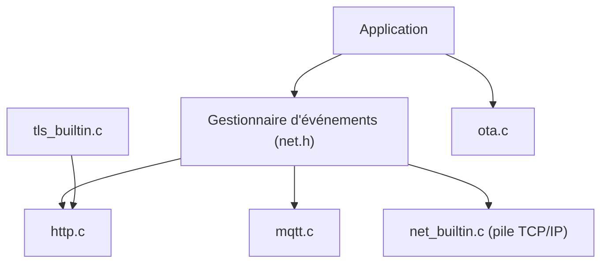

# cesanta/mongoose

> Two-file C/C++ library: TCP/IP stack, TLS 1.3, web server, MQTT and OTA updates for microcontrollers.

## The problem
On a microcontroller, assembling lwIP, mbedTLS, an HTTP server, an MQTT client and an OTA mechanism is expensive to integrate.

## What it actually does
Provides HTTP, WebSocket, MQTT, Modbus-TCP, SNTP, asynchronous DNS and TLS 1.3, with a built-in TCP/IP stack or one layered on lwIP or Zephyr. Includes drivers for STM32, NXP, ESP32 and other chips, firmware updates and dashboard assets.

## How it is wired


## Trying it
```bash
cc main.c mongoose.c
```
With `mongoose.h` and an event handler as in the README examples (HTTP server on port 8000, MQTT client).

## Cost and gotchas
Dual license: GPLv2 for open source, commercial license for closed products (support and security fixes in advance). The catalog flags an unidentified license. Contributing: a CLA must be signed.

## What it is not
Not a data/AI component: it is an embedded network stack. "No dependencies" does not exempt you from the commercial license for closed code.

## Alternatives
- lwIP + mbedTLS + httpd + MQTT client: the assembly the README aims to replace.

## For you
Outside the data/AI/MLOps scope, except for an IoT or edge project: ignore.
