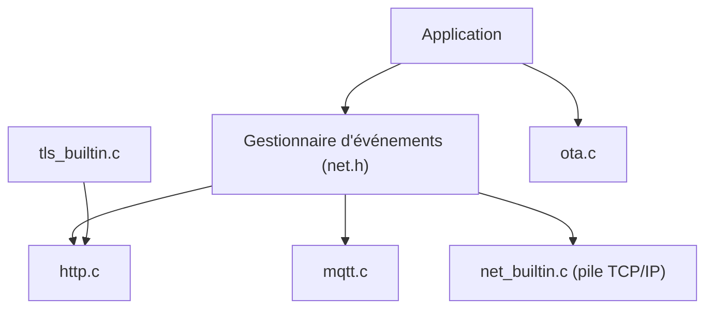

# cesanta/mongoose

> Bibliothèque C/C++ en deux fichiers : pile TCP/IP, TLS 1.3, serveur web, MQTT et mises à jour OTA pour microcontrôleurs.

## Le problème
Sur un microcontrôleur, assembler lwIP, mbedTLS, un serveur HTTP, un client MQTT et un mécanisme OTA coûte cher en intégration.

## Ce que ça fait vraiment
Fournit HTTP, WebSocket, MQTT, Modbus-TCP, SNTP, DNS asynchrone et TLS 1.3, avec pile TCP/IP intégrée ou posée sur lwIP ou Zephyr. Inclut des pilotes pour STM32, NXP, ESP32 et d'autres puces, des mises à jour de firmware et des assets de tableau de bord.

## Comment c'est branché


## Essayer
```bash
cc main.c mongoose.c
```
Avec `mongoose.h` et un gestionnaire d'événements comme dans les exemples du README (serveur HTTP sur le port 8000, client MQTT).

## Coût et pièges
Double licence : GPLv2 pour l'open source, licence commerciale pour les produits fermés (support et correctifs de sécurité anticipés). Le catalogue signale une licence non identifiée. Contribution : CLA à signer.

## Ce que ce n'est pas
Ce n'est pas un composant de data/IA : c'est de la pile réseau embarquée. Le « sans dépendance » n'exempte pas de la licence commerciale pour du code fermé.

## Alternatives
- lwIP + mbedTLS + httpd + client MQTT : l'assemblage que le README cherche à remplacer.

## Pour toi
Hors périmètre data/IA/MLOps, sauf projet IoT ou edge : à ignorer.

