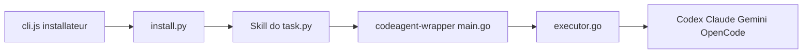

# cexll/myclaude

> Collection of workflows, commands and skills for Claude Code with multi-backend execution through a Go wrapper.

## The problem
Organizing AI-assisted development (planning, review, tests) means rewriting the same commands and agents for each tool.

## What it actually does
An `npx` installer drops modules into `~/.claude`: `do` (5-phase development, recommended), `omo` (multi-agent routing), `bmad`, `requirements`, `essentials` (11 commands), `sparv`, plus skills (browser, codex, gemini…). Claude Code orchestrates, and the `codeagent-wrapper` binary (Go) executes the tasks via Codex, Claude, Gemini or OpenCode, with parallel task planning.

## How it is wired


## Trying it
```bash
npx github:stellarlinkco/myclaude
npx github:stellarlinkco/myclaude --list
npx github:stellarlinkco/myclaude --update
```

## Cost and gotchas
The backend CLIs must be installed and authenticated: tokens at your expense. Installation overwrites files in `~/.claude` (`--force`). Several skill families cited in the README are absent from the analyzed tree.

## What it is not
Not an agent in itself: it is configuration and a wrapper. AGPL-3.0 license, with a commercial license offered on contact to avoid its obligations.

## Alternatives
No alternative named in the README.

## For you
Worth watching: useful if you want a multi-agent workflow framework for your code, but the AGPL and the installation into your global configuration call for caution.
