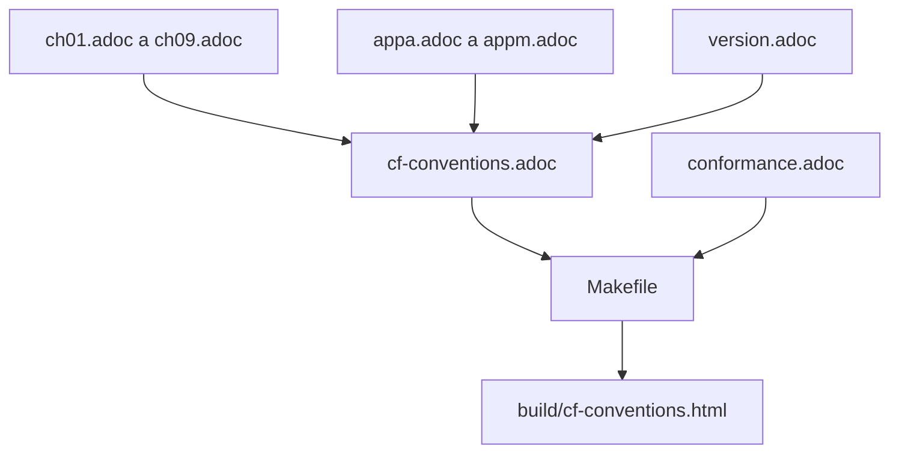

# cf-convention/cf-conventions

> Official sources of the CF metadata conventions for climate and forecast data.

## The problem
Without a common convention, geophysical data files (grids, units, coordinates) each describe themselves in their own way and cannot be exchanged.

## What it actually does
Repository of the standard's AsciiDoc sources: chapters, appendices and conformance documents. A Makefile produces the HTML and PDF versions, and pre-commit scripts clean up whitespace.

## How it is wired


## Trying it
```bash
sudo apt install ruby
gem install asciidoctor
sudo apt install make
git clone git@github.com:cf-convention/cf-conventions.git
make html
make pdf
```

## Cost and gotchas
Ruby, Asciidoctor and Make required to build. The published version is readable online without installing anything.

## What it is not
Not a library: a specification. It validates nothing on its own.

## Alternatives
- No alternative named in the README.

## For you
Watch: worth reading if you handle NetCDF or climate data, useless otherwise.
