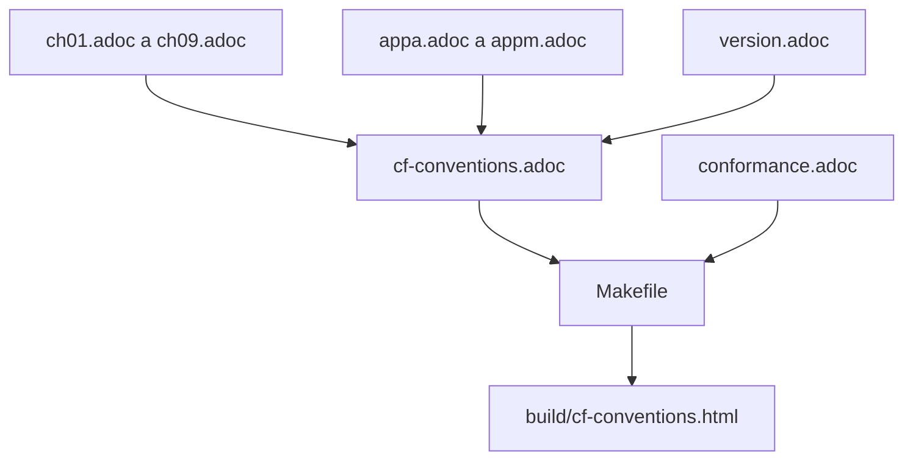

# cf-convention/cf-conventions

> Sources officielles des conventions de métadonnées CF pour les données climatiques et de prévision.

## Le problème
Sans convention commune, les fichiers de données géophysiques (grilles, unités, coordonnées) se décrivent chacun à leur façon et ne s'échangent pas.

## Ce que ça fait vraiment
Dépôt de sources AsciiDoc de la norme : chapitres, annexes et documents de conformité. Un Makefile produit les versions HTML et PDF, des scripts de pre-commit nettoient les espaces.

## Comment c'est branché


## Essayer
```bash
sudo apt install ruby
gem install asciidoctor
sudo apt install make
git clone git@github.com:cf-convention/cf-conventions.git
make html
make pdf
```

## Coût et pièges
Ruby, Asciidoctor et Make requis pour compiler. La version publiée est lisible en ligne sans rien installer.

## Ce que ce n'est pas
Pas une bibliothèque : une spécification. Elle ne valide rien toute seule.

## Alternatives
- Aucune alternative nommée dans le README.

## Pour toi
Surveiller : à lire si tu manipules des données NetCDF ou climatiques, inutile sinon.

