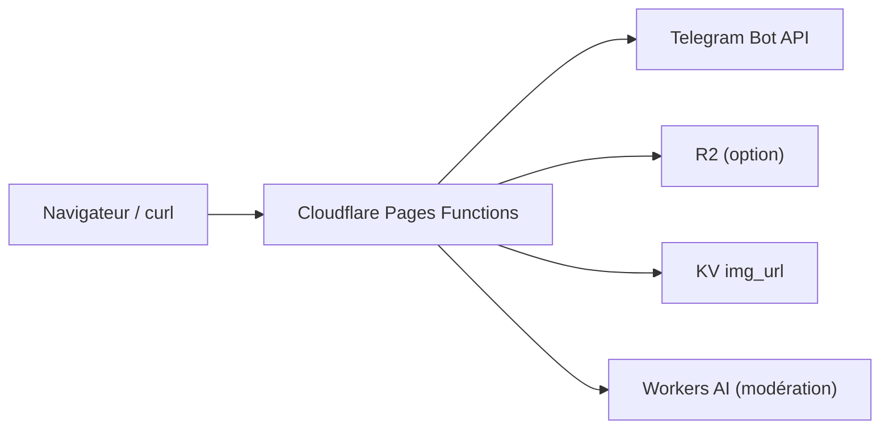

# cf-pages/Telegraph-Image

> Free image host on Cloudflare Pages, with storage in a Telegram channel or in R2.

## The problem
Hosting your images requires a server and a domain name, and the old Telegraph API has been shut down.

## What it actually does
A Cloudflare Pages project with file functions: upload via `POST /upload`, storage through the Telegram bot API or in an R2 bucket. Optional dashboard (KV), short links, upload protection with Basic Auth, allowlist or blocklist, anti-hotlinking and moderation by Workers AI.

## How it is wired


## Trying it
```bash
curl -F "file=@/path/to/image.png" https://your.domain/upload
npm install
npm start
npm test
```

## Cost and gotchas
A Cloudflare account, a Telegram bot and a channel are required. Cloudflare free quotas (100,000 requests per day, 1,000 KV writes); Telegram limits to about 20 messages per minute and 20 MB served. The README offers `disable_telemetry`.

## What it is not
It is not guaranteed hosting: everything relies on Telegram and Cloudflare, and the dashboard's "delete" button does not delete the source file.

## Alternatives
No alternative named in the README (it cites Flickr and imgur as targeted services).

## For you
Ignore: an image host diverted onto Telegram, fragile and unrelated to data, AI or MLOps work.
