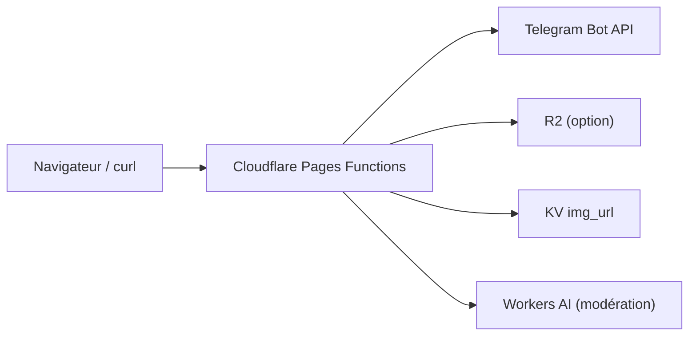

# cf-pages/Telegraph-Image

> Hébergeur d'images gratuit sur Cloudflare Pages, avec stockage dans un canal Telegram ou dans R2.

## Le problème
Héberger ses images demande un serveur et un nom de domaine, et l'ancienne API Telegraph a été fermée.

## Ce que ça fait vraiment
Projet Cloudflare Pages avec fonctions de fichiers : upload par `POST /upload`, stockage via l'API de bot Telegram ou dans un seau R2. Tableau de bord optionnel (KV), liens courts, protection de l'envoi par Basic Auth, liste blanche ou noire, anti-hotlinking et modération par Workers AI.

## Comment c'est branché


## Essayer
```bash
curl -F "file=@/path/to/image.png" https://your.domain/upload
npm install
npm start
npm test
```

## Coût et pièges
Compte Cloudflare, bot Telegram et canal requis. Quotas gratuits Cloudflare (100 000 requêtes par jour, 1 000 écritures KV) ; Telegram limite à environ 20 messages par minute et 20 Mo servis. Le README propose `disable_telemetry`.

## Ce que ce n'est pas
Ce n'est pas un hébergement garanti : tout repose sur Telegram et Cloudflare, et le bouton « supprimer » du tableau de bord ne supprime pas le fichier source.

## Alternatives
Aucune alternative nommée dans le README (il cite Flickr et imgur comme services visés).

## Pour toi
À ignorer : un hébergeur d'images détourné sur Telegram, fragile et sans rapport avec un travail data, IA ou MLOps.

