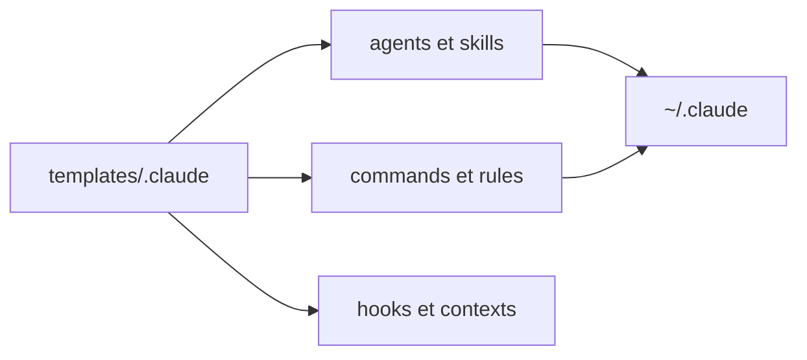

# cfrs2005/claude-init

> Claude Code configuration templates in Chinese, archived, as a learning reference.

## The problem
Chinese developers new to Claude Code lacked configuration examples in Chinese.

## What it actually does
A `templates/.claude/` folder with 9 agents, skills, 10 commands, 8 rules, hooks, contexts and MCP configurations. Part of it comes from Everything Claude Code, translated. You copy the useful files into `~/.claude/`. The project is marked as archived for learning.

## How it is wired
Simplified diagram based on the sheet, no diagram provided.



## Trying it
```bash
git clone https://github.com/cfrs2005/claude-init.git
cd claude-init
ls templates/.claude/
cp templates/.claude/agents/planner.md ~/.claude/agents/
```

## Cost and gotchas
Free, MIT. Windows not supported. The configurations may be outdated compared with recent versions of Claude Code.

## What it is not
Not a translation or a replacement for Claude Code. The author recommends using the official version. The GitHub repository is not archived, only the README says so.

## Alternatives
Everything Claude Code, the source of the translated configuration. Claude Code Development Kit, the original inspiration.

## For you
Ignore: the author himself advises against relying on it, and the original source (Everything Claude Code) is preferable.
