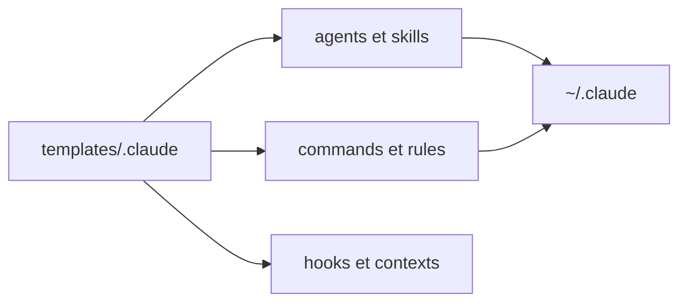

# cfrs2005/claude-init

> Modèles de configuration Claude Code en chinois, archivés, à titre de référence d'apprentissage.

## Le problème
Les développeurs chinois débutants avec Claude Code manquaient d'exemples de configuration en chinois.

## Ce que ça fait vraiment
Un dossier `templates/.claude/` avec 9 agents, des skills, 10 commandes, 8 règles, des hooks, des contextes et des configurations MCP. Une partie vient d'Everything Claude Code, traduite. On copie les fichiers utiles dans `~/.claude/`. Le projet est marqué archivé pour apprentissage.

## Comment c'est branché
Schéma simplifié d'après la fiche, sans diagramme fourni.



## Essayer
```bash
git clone https://github.com/cfrs2005/claude-init.git
cd claude-init
ls templates/.claude/
cp templates/.claude/agents/planner.md ~/.claude/agents/
```

## Coût et pièges
Gratuit, MIT. Windows non pris en charge. Les configurations peuvent être périmées face aux versions récentes de Claude Code.

## Ce que ce n'est pas
Pas une traduction ni un remplacement de Claude Code. L'auteur recommande d'utiliser la version officielle. Le dépôt GitHub n'est pas archivé, seul le README l'annonce.

## Alternatives
Everything Claude Code, source de la configuration traduite. Claude Code Development Kit, inspiration d'origine.

## Pour toi
À ignorer : l'auteur déconseille lui-même de s'y fier, et la source d'origine (Everything Claude Code) est préférable.

