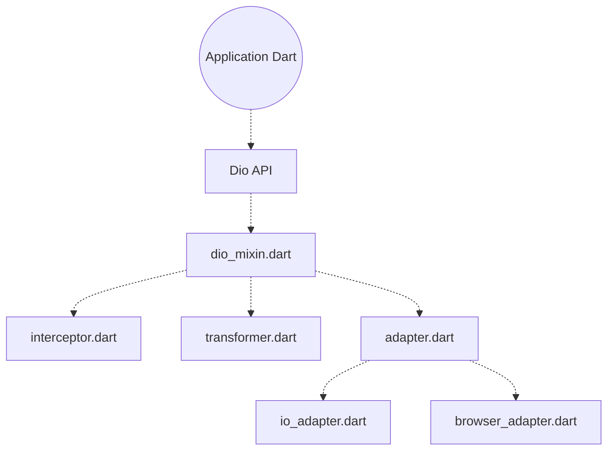

# cfug/dio

> HTTP client for Dart and Flutter, with interceptors, cancellation and adapters, aimed at Dart application developers.

## The problem
Making configured HTTP requests in Dart means reinventing cancellation, body transformation and error handling.

## What it actually does
The repository is the root of a workspace: the `dio` package (request engine, options, cancellation, response, interceptors, multipart forms, transformers) and plugins (cookie management, compatibility layer, HTTP/2 adapter, native adapter, web adapter). The root README details nothing: it points to each sub-path.

## How it is wired


## Trying it
```bash
# Aucune commande documentée dans le README racine ; voir le README du paquet dio.
```

## Cost and gotchas
Free, nothing to configure. Major and minor versions can break the API: the README points to the migration guide.

## What it is not
It is not a client for Python or the data world: Dart/Flutter only. The root README is just an index of packages.

## Alternatives
No alternative cited in the README.

## For you
Ignore for a data / AI / MLOps profile: it is a Dart/Flutter building block, outside your usual stack.
