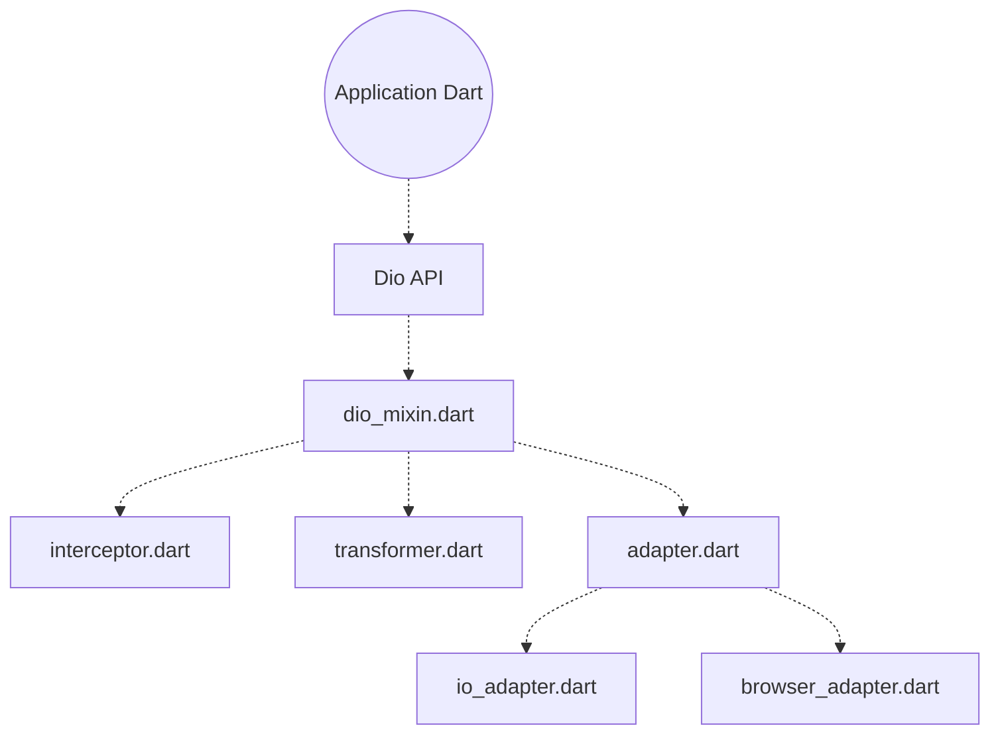

# cfug/dio

> Client HTTP pour Dart et Flutter, avec intercepteurs, annulation et adaptateurs, pour développeurs d'applications Dart.

## Le problème
Faire des requêtes HTTP configurées en Dart demande de réinventer annulation, transformation des corps et gestion des erreurs.

## Ce que ça fait vraiment
Le dépôt est la base d'un espace de travail : le paquet `dio` (moteur de requêtes, options, annulation, réponse, intercepteurs, formulaires multipart, transformeurs) et des plugins (gestion des cookies, couche de compatibilité, adaptateur HTTP/2, adaptateur natif, adaptateur web). Le README racine ne détaille rien : il renvoie vers chaque sous-chemin.

## Comment c'est branché


## Essayer
```bash
# Aucune commande documentée dans le README racine ; voir le README du paquet dio.
```

## Coût et pièges
Gratuit, rien à configurer. Les versions majeures et mineures peuvent casser l'API : le README renvoie au guide de migration.

## Ce que ce n'est pas
Ce n'est pas un client pour Python ou le monde data : uniquement Dart/Flutter. Le README racine n'est qu'un index de paquets.

## Alternatives
Aucune alternative citée dans le README.

## Pour toi
À ignorer pour un profil data / IA / MLOps : c'est une brique Dart/Flutter, hors de ta pile habituelle.

