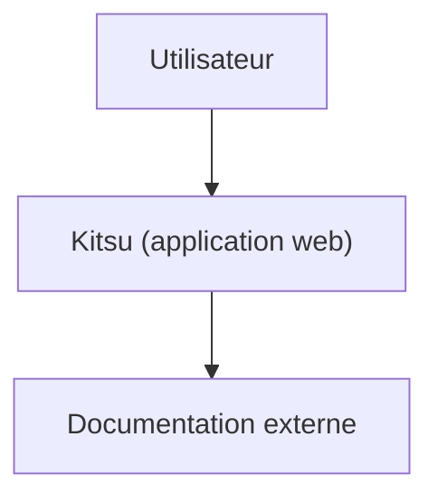

# cgwire/kitsu

> Web collaboration platform for animation, visual effects and video game studios.

## The problem
Creative production teams struggle to communicate and to track deliveries.

## What it actually does
Web application for production tracking and collaboration between stakeholders. The README points to a documentation site for features and installation. Published by CGWire (France), used by more than 300 studios.

## How it is wired

Simplified diagram based on the sheet, no diagram provided.

## Trying it
```bash
# Aucune commande documentée dans le README.
```

## Cost and gotchas
Installation is not documented in the README. AGPL-3.0 license: obligations apply when exposed over a network.

## What it is not
Not a data or AI tool: it is an audiovisual production management tool.

## Alternatives
No alternative named in the README.

## For you
Off-topic for a data / AI / MLOps profile: ignore.
